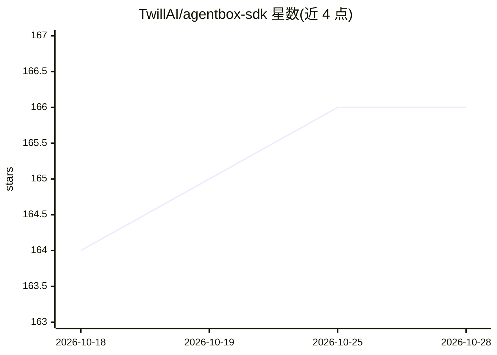

# TwillAI/agentbox-sdk

⭐ 166 · TypeScript · 推送 2026-10-14 · [GitHub](https://github.com/TwillAI/agentbox-sdk) · [官网](https://twill.ai) · 组织维护

**在沙箱中运行 AI 编码代理的 TypeScript SDK，统一 API 切换代理与沙箱**

AgentBox 是一个开源 TypeScript SDK，用于在沙箱环境中运行 AI 编码代理。它不以非交互 CLI 调用方式包装代理，而是将每个代理作为服务器进程在沙箱内启动，经 WebSocket/HTTP 通信，保留审批流、工具控制与流式事件。支持三种代理（claude-code、opencode、codex）与五种沙箱（local-docker、e2b、modal、daytona、vercel），可混搭替换而不改业务代码。提供后台任务生命周期管理、事件回放与停放运行（parked runs）机制；要求 Node>=20，目标代理 CLI 须预装在沙箱镜像中。

## 筛选速览

| 维度 | 判定 | 备注 |
|---|---|---|
| AI 角色 | `ai-ecosystem` | LLM/agent 周边工具 |
| 许可风险 | `none` | — |
| 部署形态 | `library` | 以包/库形式分发 |
| 模型依赖 | — | README 未给出锁定关系 |
| 硬件要求 | — | 无带数字的原话,不猜 |
| 安装摩擦 | `low` | 无编译、无系统依赖或容器化 |
| 成熟度 | — | 结构信号不足 |

## 能力要点

- 代理以服务器进程运行于沙箱内，保留审批流与流式事件
- 代理与沙箱提供商可混搭替换（3 种代理 × 5 种沙箱）
- 统一的 background.tasks 事件模型管理后台任务与停放运行
- npx agentbox image build 按提供商构建沙箱镜像

## 适用场景

- 在应用中嵌入可切换的 AI 编码代理运行时
- 统一对接多种沙箱基础设施而无需改代码
- 构建需要审批流与后台任务管理的自动化编码工作流

## 场景标签

`Agent 框架` · 领域:Agent 开发

## 证据(README 行号)

> L7: Unlike wrappers that shell out to CLIs in non-interactive mode (e.g. `claude --print`), AgentBox launches each agent
> L18: - **Agents** — `claude-code`, `opencode`, `codex`
> L19: - **Sandboxes** — `local-docker`, `e2b`, `modal`, `daytona`, `vercel`

## 星数曲线

2026-10-18 164 → 2026-10-28 166（+2）

---
*卡片 v1 · prompt 1.4 · 生成 2026-10-23 · 置信度 high · 依据 README sha `5fe63b057951` · [字段定义](../../DATASET.md)*
