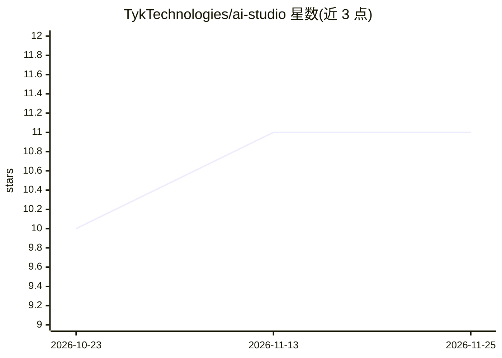

# TykTechnologies/ai-studio

⭐ 11 · Go · AGPL-3.0 · 推送 2026-11-23 · [GitHub](https://github.com/TykTechnologies/ai-studio) · [官网](https://tyk.io/tyk-ai-studio/) · 组织维护

**给企业统一管理、治理与接入 AI 的开源网关平台**

开源 AI 管理平台，面向开发者和平台团队，解决影子 AI、合规、安全与成本控制问题。核心是 AI 网关，代理多厂商 LLM 访问并提供访问控制、用量监控、限速与内容过滤；附带开发者服务目录（AI Portal）、聊天界面、MCP 集成与插件系统（gRPC 隔离进程、统一 SDK）。分社区版（AGPL v3 开源）与企业版（预算管理、SSO、审计日志等，需许可证），提供 Docker Compose、Helm、源码构建等部署方式。

## 筛选速览

| 维度 | 判定 | 备注 |
|---|---|---|
| AI 角色 | `ai-ecosystem` | LLM/agent 周边工具 |
| 许可风险 | `viral` | AGPL-3.0 |
| 部署形态 | `self-host` | docker 或自建部署 |
| 模型依赖 | local-ok | 支持本地模型 |
| 硬件要求 | — | 无带数字的原话,不猜 |
| 安装摩擦 | `low` | 无编译、无系统依赖或容器化 |
| 成熟度 | — | 结构信号不足 |

## 能力要点

- AI 网关支持多厂商 LLM（OpenAI、Anthropic、Bedrock、Ollama 等）并集中管理凭据
- 用量监控、成本追踪、限速与预算控制（预算执行为企业版功能）
- MCP 集成：远程 MCP 连接与本地 MCP 服务器生成，流量经网关路由
- 插件系统：gRPC 隔离进程，10 类插件能力，支持本地文件/gRPC/OCI 部署

## 适用场景

- 为组织内多个 AI 厂商提供统一接入与凭据管理入口
- 按部门追踪 AI 用量与成本并执行预算控制
- 通过内容过滤与策略满足金融、医疗场景的合规要求
- 将内部 API/工具通过 MCP 接入 AI 对话流程

## 场景标签

`模型网关` · 领域:Agent 开发

## 证据(README 行号)

> L12: Tyk AI Studio is an open source platform that addresses the critical challenges organizations face when adopting AI
> L51: ### AI Gateway
> L53: - **Multi-vendor LLM support**: OpenAI, Anthropic, Mistral, Vertex AI, Bedrock, Gemini, Huggingface, Ollama, and cu

## 星数曲线

2026-10-23 10 → 2026-11-25 11（+1）

---
*卡片 v1 · prompt 1.4 · 生成 2026-11-18 · 置信度 high · 依据 README sha `e8199f779796` · [字段定义](../../DATASET.md)*
