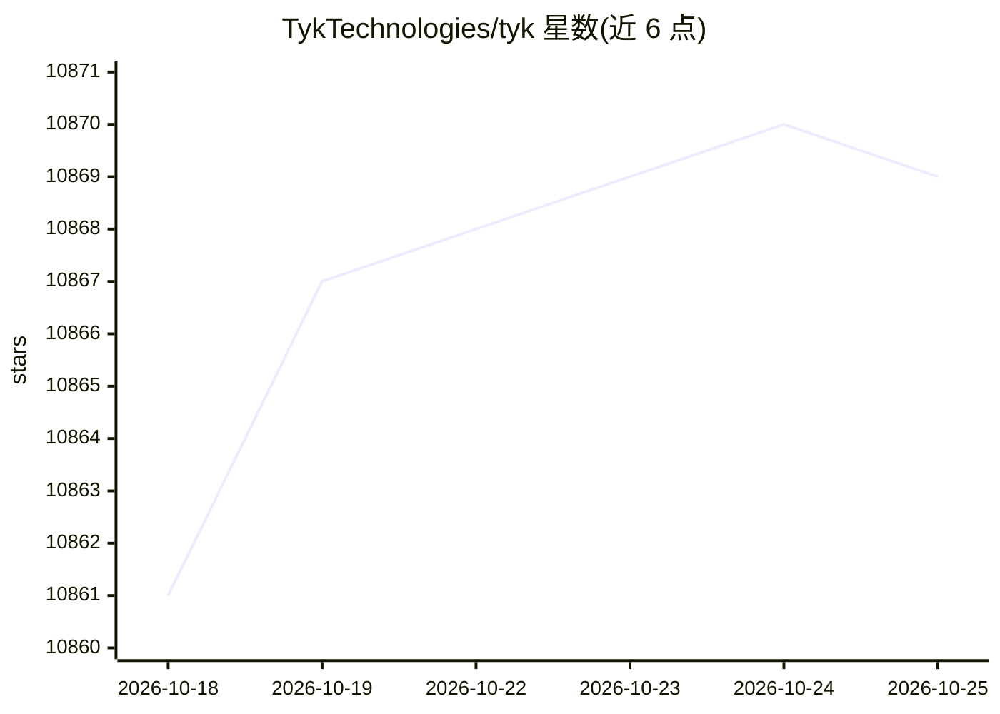

# TykTechnologies/tyk

⭐ 10,869 · Go · NOASSERTION · 推送 2026-10-23 · [GitHub](https://github.com/TykTechnologies/tyk) · [官网](https://tyk.io/docs/getting-started/quick-start) · 组织维护

**云原生开源 API 与 AI 网关：管理 REST/GraphQL/gRPC/MCP 流量**

Tyk Gateway 是以 Go 编写的云原生开源 API 与 AI 网关，支持 REST、SOAP、GraphQL、gRPC、TCP 与 MCP（Model Context Protocol）协议。提供认证（JWT/Bearer/Basic/客户端证书）、限流配额、分析日志、内容转换、多语言插件扩展等能力；MCP 网关解析 JSON-RPC 2.0 并按 tool/resource/prompt 粒度施加策略，还可从 REST API 生成 MCP 代理。面向构建与管理 API 的企业开发团队。安装方式包括 Docker、Helm/K8s、Ansible、各 Linux 发行版包与源码编译；LLM 层面的模型路由与治理由配套的 Tyk AI Studio 承担。仓库代码采用 MPL v2.0 与商业许可双许可（ee 目录）。

## 筛选速览

| 维度 | 判定 | 备注 |
|---|---|---|
| AI 角色 | `ai-ecosystem` | LLM/agent 周边工具 |
| 许可风险 | `permissive` | NOASSERTION |
| 部署形态 | `self-host` | docker 或自建部署 |
| 模型依赖 | — | README 未给出锁定关系 |
| 硬件要求 | — | 无带数字的原话,不猜 |
| 安装摩擦 | `low` | 无编译、无系统依赖或容器化 |
| 成熟度 | — | 结构信号不足 |

## 能力要点

- 支持 REST/SOAP/GraphQL/gRPC/TCP/MCP 多协议网关
- MCP 网关：解析 JSON-RPC 2.0，按 tool/resource/prompt 粒度做认证、限流与审计
- 从 REST API 直接生成 MCP 代理，无需单独搭建 MCP 服务器
- 多语言插件架构（Python/JavaScript/Go/gRPC）与 API 版本管理

## 适用场景

- 为组织内外部 API 提供统一的认证、限流与分析入口
- 在 AI agent 访问远程 MCP 服务器前加一层认证与按工具访问控制
- 把已有 REST API 以 MCP 代理形式暴露给 AI agent 使用

## 场景标签

`模型网关` · 领域:Agent 开发

## 证据(README 行号)

> L20: **Tyk Gateway** is the cloud-native, open source, enterprise-ready API and AI Gateway supporting REST, GraphQL, TCP
> L85: Tyk Gateway governs MCP traffic from AI agents, applying authentication, rate limiting and per-tool access control 
> L90: MCP Gateway: Put the gateway in front of remote Model Context Protocol servers so AI agent traffic is authenticated

## 星数曲线

2026-10-18 10,861 → 2026-10-25 10,869（+8）

---
*卡片 v1 · prompt 1.4 · 生成 2026-10-20 · 置信度 high · 依据 README sha `28e6354d5516` · [字段定义](../../DATASET.md)*
