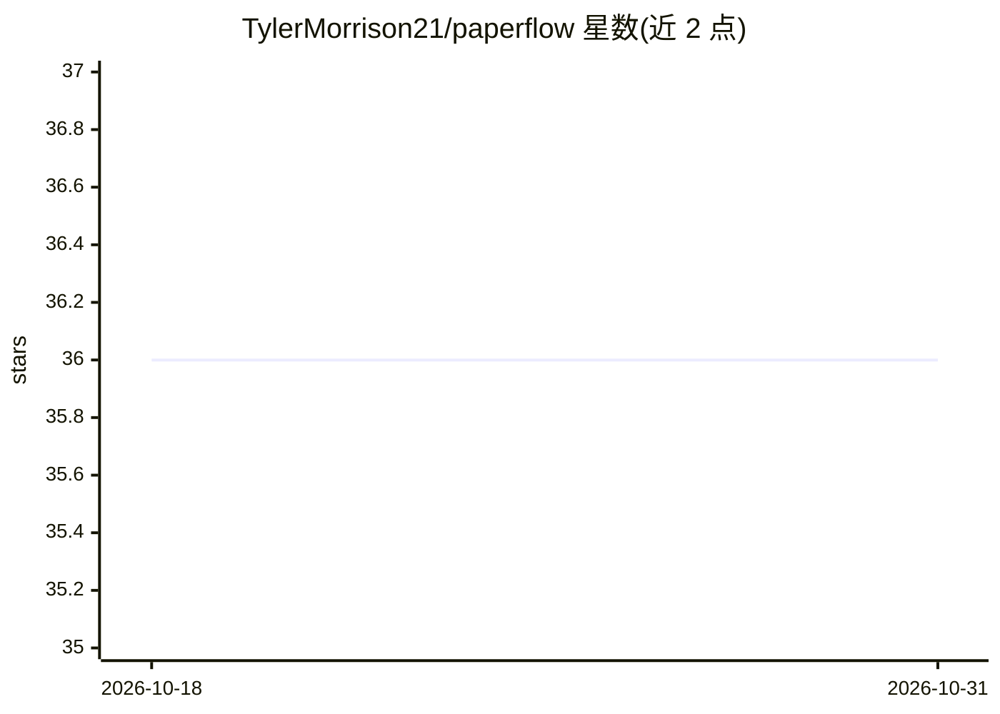

# TylerMorrison21/paperflow

⭐ 36 · Python · MIT · 推送 2026-03-24 · [GitHub](https://github.com/TylerMorrison21/paperflow) · [官网](https://paperflowing.com) · 个人维护

**PDF→Markdown 转换结果的后处理引擎，产出结构化 Markdown**

面向学术论文等 PDF 转换场景的后处理引擎：读取任意 PDF 解析器（PyMuPDF、Marker、PaddleOCR-VL、Docling、LlamaParse）产出的原始 Markdown，将 `[1]` 类引用转为标准脚注、规范化 LaTeX 分隔符、生成图表内部链接、注入 YAML frontmatter 并清理重复页眉页脚，供 Obsidian/Notion/Logseq 或 RAG 流程使用。提供 pip 包、自托管 FastAPI Web UI、Docker/NAS(Unraid) 部署与 REST API。脚注转换与图表链接在 Marker 格式输出上测试最深，Docling/LlamaParse 为部分兼容。

## 筛选速览

| 维度 | 判定 | 备注 |
|---|---|---|
| AI 角色 | `ai-ecosystem` | LLM/agent 周边工具 |
| 许可风险 | `permissive` | MIT |
| 部署形态 | `self-host` | docker 或自建部署 |
| 模型依赖 | — | README 未给出锁定关系 |
| 硬件要求 | — | 无带数字的原话,不猜 |
| 安装摩擦 | `low` | 无编译、无系统依赖或容器化 |
| 成熟度 | — | 结构信号不足 |

## 能力要点

- enhance() 将引用 [1] 转为标准脚注、规范化 LaTeX 分隔符、生成图表链接
- 注入含标题/作者/日期/抽取哈希的 YAML frontmatter，清理重复页眉页脚
- 支持 PyMuPDF/PaddleOCR-VL/Marker API/自托管 Marker/Docling/LlamaParse 多种解析器路径
- 提供 pip 包、自托管 Web UI、Docker 镜像与 REST API 三种使用方式

## 适用场景

- 把学术论文 PDF 转成可导入 Obsidian/Notion 的结构化 Markdown
- 为 RAG 知识库准备带元数据与干净引用的文档
- 在 NAS/Unraid 上自托管 PDF 转换服务并通过 API 调用

## 场景标签

`文档解析` · 领域:知识与检索

## 证据(README 行号)

> L10: PaperFlow is an open-source post-processing engine for PDF->Markdown
> L12: PyMuPDF, Docling, LlamaParse) and upgrades it into structured output

## 星数曲线

2026-10-18 36 → 2026-10-31 36（+0）

---
*卡片 v1 · prompt 1.4 · 生成 2026-10-25 · 置信度 high · 依据 README sha `619416f93abc` · [字段定义](../../DATASET.md)*
