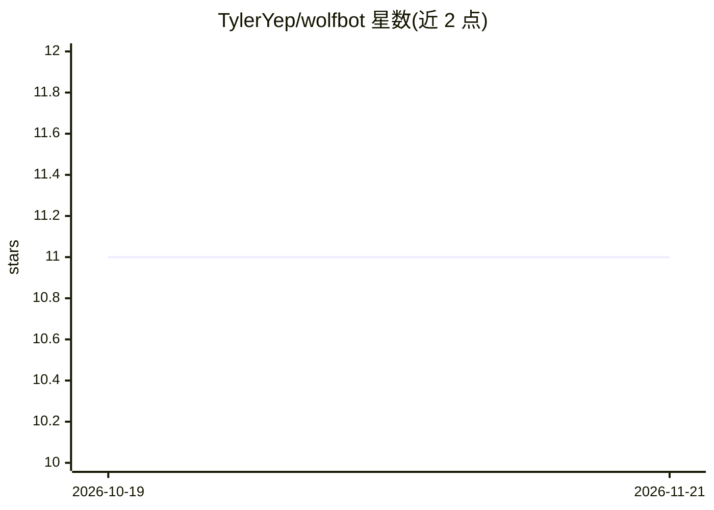

# TylerYep/wolfbot

⭐ 11 · Python · MIT · 推送 2026-11-17 · [GitHub](https://github.com/TylerYep/wolfbot) · 个人维护

**一晚终极狼人杀桌游的 AI 玩家实现与模拟器**

热门桌游 One Night Ultimate Werewolf 的开源实现，AI 玩家使用强化学习训练的决策模型代替人类出牌。用户可通过命令行参数进行人类对战、回放对局、设置日志级别，或批量模拟多局游戏并用 profiler 分析结果。玩家数量、中央牌数、所用角色及狼人阵营/村庄阵营 AI 行为均可在 const.py 中配置。需要 Python 3.13+。

## 筛选速览

| 维度 | 判定 | 备注 |
|---|---|---|
| AI 角色 | `ai-native` | 本体是模型或模型工具 |
| 许可风险 | `permissive` | MIT |
| 部署形态 | `library` | 以包/库形式分发 |
| 模型依赖 | — | README 未给出锁定关系 |
| 硬件要求 | — | 无带数字的原话,不猜 |
| 安装摩擦 | `low` | 无编译、无系统依赖或容器化 |
| 成熟度 | — | 结构信号不足 |

## 能力要点

- AI 玩家通过强化学习训练决策行为
- 支持人机交互对战与对局回放
- 批量模拟多局游戏并附带 profiler 性能分析
- 玩家数、中央牌与角色可在 const.py 中配置

## 适用场景

- 亲自扮演角色与 AI 玩家对局
- 批量模拟对局观察 AI 玩家的胜负表现
- 调整角色配置研究不同局面的策略

## 场景标签

`强化学习` · 领域:训练与推理

## 证据(README 行号)

> L3: ### One Night Ultimate Werewolf: AI Edition
> L24: - Behavior of AI players on the Werewolf Team / Village Team

## 星数曲线

2026-10-19 11 → 2026-11-21 11（+0）

---
*卡片 v1 · prompt 1.4 · 生成 2026-11-18 · 置信度 high · 依据 README sha `8396403da961` · [字段定义](../../DATASET.md)*
