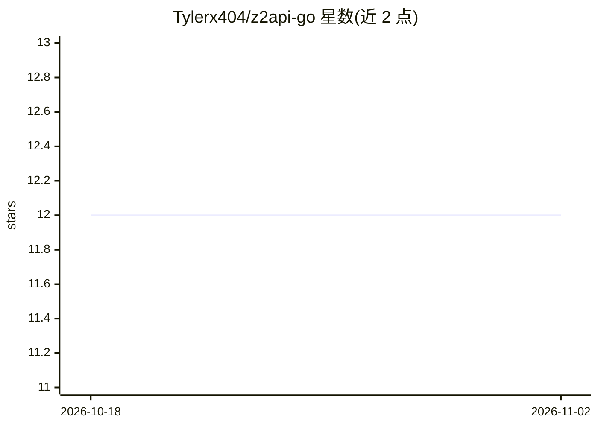

# Tylerx404/z2api-go

⭐ 12 · Go · MIT · 推送 2026-02-12 · [GitHub](https://github.com/Tylerx404/z2api-go) · 个人维护 · 中文 README

**将 Z.ai 网页接口转成 OpenAI/Anthropic 兼容 API 的 Go 代理**

用 Go 编写的 Z.ai 代理 API 服务：将 Z.ai 的模型访问（默认 glm-5）封装为 OpenAI 与 Anthropic 兼容的 API 接口，供已有客户端或应用直接接入。通过环境变量配置：TOKEN 支持匿名/认证两种模式，可设端口与调试开关，THINK_TAGS_MODE 提供思考标签的四种处理模式（reasoning/think/strip/details）。提供源码运行（go run）与 docker-compose 两种部署方式，MIT 许可证。

## 筛选速览

| 维度 | 判定 | 备注 |
|---|---|---|
| AI 角色 | `ai-ecosystem` | LLM/agent 周边工具 |
| 许可风险 | `permissive` | MIT |
| 部署形态 | `self-host` | docker 或自建部署 |
| 模型依赖 | — | README 未给出锁定关系 |
| 硬件要求 | — | 无带数字的原话,不猜 |
| 安装摩擦 | `low` | 无编译、无系统依赖或容器化 |
| 成熟度 | — | 结构信号不足 |

## 能力要点

- OpenAI 与 Anthropic 双兼容 API 接口
- 匿名模式与 TOKEN 认证模式两种访问方式
- 思考标签处理模式（reasoning/think/strip/details）
- 提供源码与 docker-compose 两种部署方式

## 适用场景

- 让仅支持 OpenAI/Anthropic API 的工具接入 Z.ai 模型
- 在自建服务中以标准 API 格式调用 glm-5
- 通过 Docker 快速部署代理服务

## 场景标签

`模型网关` · 领域:Agent 开发

## 证据(README 行号)

> L3: Proxy API for Z.ai compatible with OpenAI and Anthropic, written in Go.
> L41: |`MODEL`|Default model|`glm-5`|

## 星数曲线

2026-10-18 12 → 2026-11-02 12（+0）

---
*卡片 v1 · prompt 1.4 · 生成 2026-11-01 · 置信度 high · 依据 README sha `925828bf50d4` · [字段定义](../../DATASET.md)*
