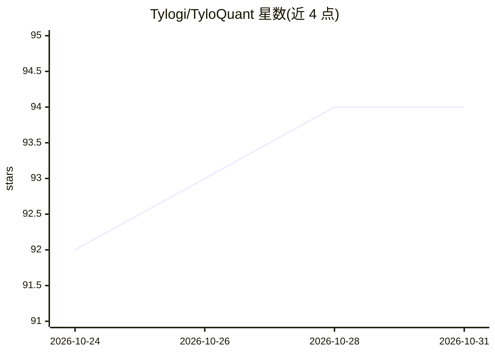

# Tylogi/TyloQuant

⭐ 94 · C++ · Apache-2.0 · 推送 2026-10-30 · [GitHub](https://github.com/Tylogi/TyloQuant) · 组织维护 · 中文 README

**本地大模型混合精度量化与推理运行时（MFQ）**

量化与推理一体系统，面向在本地硬件运行大模型的开发者：提供细粒度混合精度校准、NINT/NVQ 紧凑权重格式，以及原生 C++ 的 CUDA/Metal 运行时（ROCm 开发中）。桌面应用 MFQ Studio 集成模型下载、加载、内存预算、量化可视化与基准测试；MFQ Server 暴露 OpenAI/Anthropic 兼容 API，支持多模型 LRU 驱逐、跨 RAM/SSD 的前缀与 KV 缓存。CUDA 后端可组合 VRAM、内存与 SSD 运行超出显存的模型。支持 Qwen、DeepSeek-V4-Flash、MiniCPM-o、GLM、Gemma 等架构，模型发布于 Hugging Face 与 ModelScope。源码构建需 Git、uv、CMake 3.26+ 与 C++ 工具链。

## 筛选速览

| 维度 | 判定 | 备注 |
|---|---|---|
| AI 角色 | `ai-ecosystem` | LLM/agent 周边工具 |
| 许可风险 | `permissive` | Apache-2.0 |
| 部署形态 | `None` |  |
| 模型依赖 | — | README 未给出锁定关系 |
| 硬件要求 | — | 无带数字的原话,不猜 |
| 安装摩擦 | `high` | 编译与系统依赖俱全 |
| 成熟度 | `idea` | |

## 能力要点

- 逐专家/逐投影的细粒度混合精度分配（NINT 与 NVQ 格式可同层共存）
- 原生 C++ CUDA/Metal 运行时，支持 SSD 流式加载 MoE 专家与 PLE 表
- MFQ Studio 桌面应用集成下载、加载、量化可视化与基准测试
- OpenAI/Anthropic 兼容 API，多模型管理与跨 RAM/SSD 缓存

## 适用场景

- 在 Apple Silicon 或 NVIDIA 显卡上本地运行大型 MoE 模型
- 按内存与质量预算选择量化档位并核验量化质量（KLD/Top1）
- 通过 OpenAI/Anthropic 兼容 API 为应用和 agent 提供本地模型服务
- 对自有 HF Safetensors 模型做混合精度量化

## 场景标签

`模型量化` `推理引擎` · 领域:训练与推理

## 证据(README 行号)

> L9: MFQ is a quantization and inference system for running large models on local
> L12: memory, storage, and latency budgets. Download and run models in **MFQ Studio**,
> L13: or connect applications and agents through OpenAI- and Anthropic-compatible APIs.

## 星数曲线

2026-10-24 92 → 2026-10-31 94（+2）

---
*卡片 v1 · prompt 1.4 · 生成 2026-10-23 · 置信度 high · 依据 README sha `2cc217445056` · [字段定义](../../DATASET.md)*
