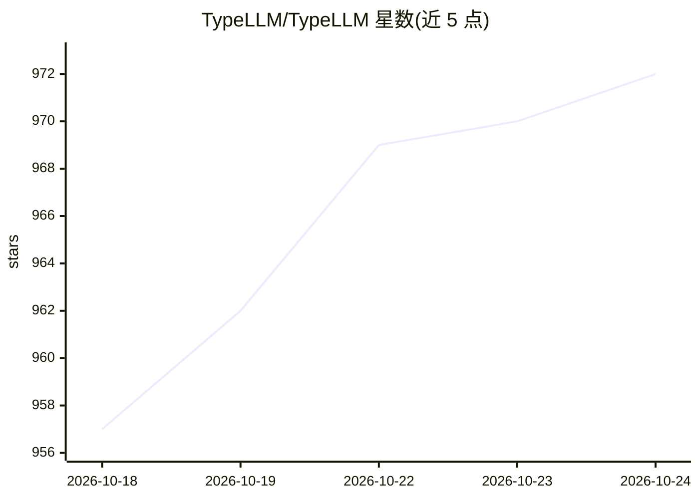

# TypeLLM/TypeLLM

⭐ 972 · Python · Apache-2.0 · 推送 2026-10-20 · [GitHub](https://github.com/TypeLLM/TypeLLM) · [官网](https://typellm.ai) · 组织维护

**让现有 LLM 输出类型安全结构化结果的生成框架**

基于 SGLang 构建的结构化生成框架：在不改动模型架构与权重的前提下，通过 JSON Schema 声明字段（字符串/整数/枚举/对象/数组等），使自回归 LLM 产出受模式约束的回答，枚举值不越界。支持条件字段、depends_on 依赖图、按字段开启 thinking 模式及预算、图像输入与排列平均。可调用托管的 TypeLLM API，或用 Python 客户端指向自架的 SGLang 服务器（示例为 Qwen3.8-27B）。自架时枚举最多 26 个值、数组每次最多 50 项；托管 API 提供 5 美元额度。

## 筛选速览

| 维度 | 判定 | 备注 |
|---|---|---|
| AI 角色 | `ai-ecosystem` | LLM/agent 周边工具 |
| 许可风险 | `permissive` | Apache-2.0 |
| 部署形态 | `library` | 以包/库形式分发 |
| 模型依赖 | — | README 未给出锁定关系 |
| 硬件要求 | — | 无带数字的原话,不猜 |
| 安装摩擦 | `medium` | 含编译或系统依赖之一 |
| 成熟度 | — | 结构信号不足 |

## 能力要点

- JSON Schema 声明字段，输出保证符合模式（枚举不越界）
- depends_on 依赖图与 when 条件字段，独立字段并行执行
- 按字段的 thinking 模式，支持 thinking_budget 与 auto 级别
- 支持图像输入与对象/数组输出，continue_from 分段续传

## 适用场景

- 从收据、工单等文本中按预定义 schema 提取类型化字段
- 对枚举/布尔字段获取概率分布用于置信度筛选
- 在自架 SGLang + Qwen 模型上做无越界幻觉的决策类任务

## 场景标签

`文档解析` · 领域:知识与检索

## 证据(README 行号)

> L43: TypeLLM brings type-safe generation to existing autoregressive LLMs without changing their architecture or weights.
> L55: 5. **Made for open autoregressive LLMs** — Use compatible models you already serve with SGLang.

## 星数曲线

2026-10-18 957 → 2026-10-24 972（+15）

---
*卡片 v1 · prompt 1.4 · 生成 2026-10-21 · 置信度 high · 依据 README sha `c3a90dca2142` · [字段定义](../../DATASET.md)*
