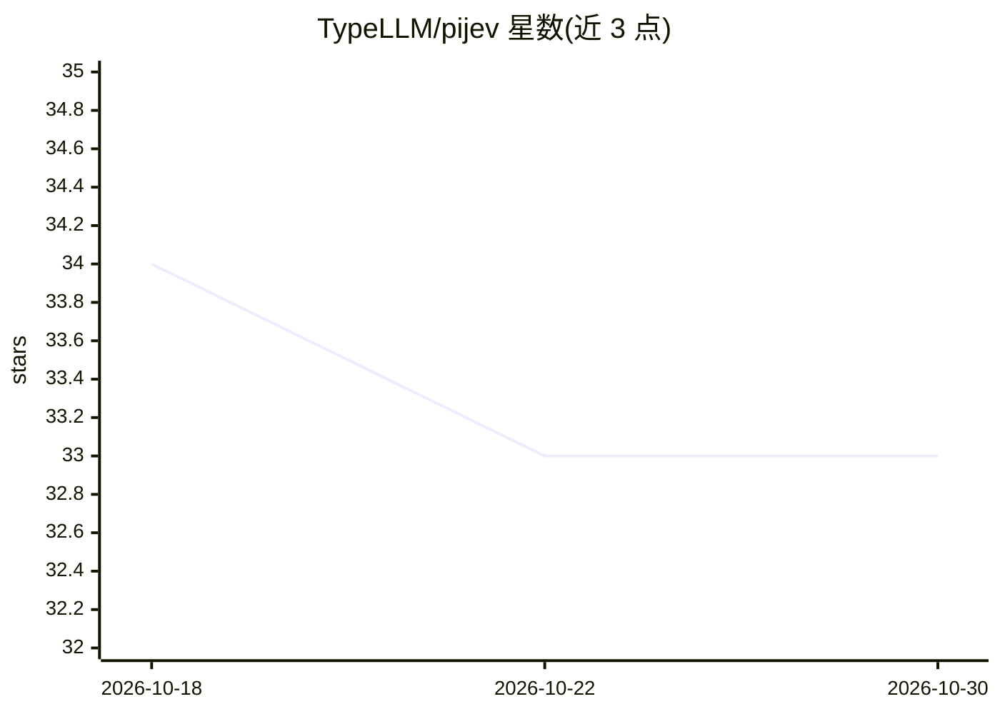

# TypeLLM/pijev

⭐ 33 · Python · Apache-2.0 · 推送 2026-09-28 · [GitHub](https://github.com/TypeLLM/pijev) · 组织维护

**让 Jev 选择题输出对选项顺序不变的 Python 客户端封装库**

pijev 是 TypeSafe Python SDK 的第三方扩展：把 Jev 的 Choice 问答在多个选项排列下于单次 system_one 请求中批量求值，按标签对齐概率后取平均，以最高均值概率作为返回选择，从而消除选项顺序变化导致的概率漂移。通过一行 import 替换即可使用，保持官方响应类型；基于凸损失函数的 Jensen 不等式给出 Brier 分数与 log loss 不劣于所含排列平均的理论保证。默认使用均衡排列集（K 个选项 K 种排列，奇数时 2K），支持整数随机采样与 seed 固定；仅平均 Choice，Noul 与 Score 原样透传；confidence 为均值概率而非原生置信分。

## 筛选速览

| 维度 | 判定 | 备注 |
|---|---|---|
| AI 角色 | `ai-ecosystem` | LLM/agent 周边工具 |
| 许可风险 | `permissive` | Apache-2.0 |
| 部署形态 | `library` | 以包/库形式分发 |
| 模型依赖 | — | README 未给出锁定关系 |
| 硬件要求 | — | 无带数字的原话,不猜 |
| 安装摩擦 | `low` | 无编译、无系统依赖或容器化 |
| 成熟度 | — | 结构信号不足 |

## 能力要点

- 单次请求内评估多个选项排列并按标签对齐取概率平均
- Brier 分数与 log loss 不劣于所含排列平均的凸损失保证
- 一行 import 替换即可替换官方 typesafe_sdk 调用
- n_permutations 支持 auto/整数采样/全排列，seed 可固定采样

## 适用场景

- 消除多选项决策输出对选项书写顺序的敏感
- 对 Jev 选择题结果获得跨排列的稳定概率估计
- 在不改动现有 SDK 调用代码结构的前提下改进校准

## 场景标签

 · 领域:LLM 应用工具/可靠性

## 证据(README 行号)

> L59: from pijev import Choice, TypeSafeClient
> L191: - Official interface: TypeSafe Python SDK.

## 星数曲线

2026-10-18 34 → 2026-10-30 33（-1）

---
*卡片 v1 · prompt 1.4 · 生成 2026-10-25 · 置信度 high · 依据 README sha `63e8543f6740` · [字段定义](../../DATASET.md)*
