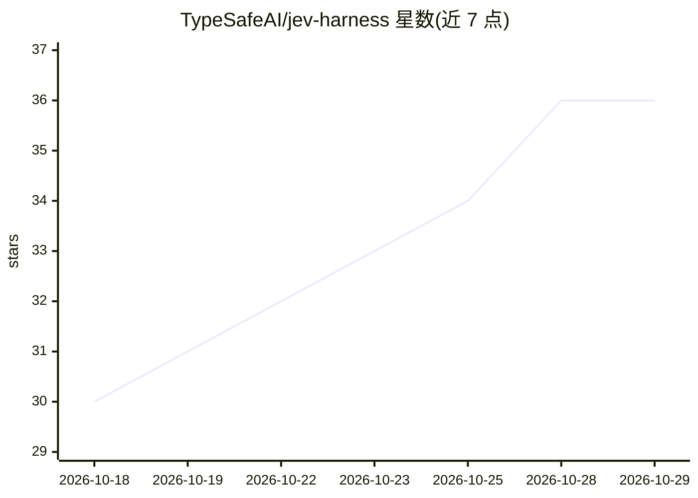

# TypeSafeAI/jev-harness

⭐ 36 · TypeScript · MIT · 推送 2026-10-27 · [GitHub](https://github.com/TypeSafeAI/jev-harness) · [官网](https://jev.guru) · 个人维护

**LLM 编码提案的审查决策框架：证据留痕、代码裁决**

面向编码 agent 的提案-审查契约库：LLM 提出一个动作（read_file/propose_patch），Jev 模型回答四个固定问题（是否推进任务、证据是否支持、是否有无关改动、是否需澄清），确定性决策表输出 reject/unavailable/proposal_only/permit。不执行补丁、不授权动作，宿主负责验证快照、传输与授权。提供 v1 回执类型与可选 SHA-256 绑定/离线回放适配器、25 组离线合成基准与 Next.js 演示。源码分发（Node 22+ / pnpm），未发布到包管理器，研究阶段。

## 筛选速览

| 维度 | 判定 | 备注 |
|---|---|---|
| AI 角色 | `ai-ecosystem` | LLM/agent 周边工具 |
| 许可风险 | `permissive` | MIT |
| 部署形态 | `library` | 以包/库形式分发 |
| 模型依赖 | — | README 未给出锁定关系 |
| 硬件要求 | — | 无带数字的原话,不猜 |
| 安装摩擦 | `low` | 无编译、无系统依赖或容器化 |
| 成熟度 | `idea` | |

## 能力要点

- 四问题固定契约与确定性决策表（阈值默认 0.8，未校准）
- Receipt v1 回执与可选 SHA-256 绑定/离线回放（非签名认证）
- 不执行代码、不授权动作，执行/沙箱/存储均为宿主职责
- 25 组离线合成提案-审查基准（base 7/25 vs +Jev 25/25，脚本化模拟值）

## 适用场景

- 为编码 agent 的每步提案建立可审计的证据链
- 在允许补丁应用前用固定问题集做门控审查
- 离线回放核验历史决策的绑定与状态一致性

## 场景标签

`代码审查` · 领域:编码与开发

## 证据(README 行号)

> L5: A research-stage proposal-review contract: an LLM proposes one action, Jev
> L6: answers four narrow questions, and code produces evidence for a host to consider.
> L86: The planned proposal tools remain `read_file` and `propose_patch`. A proposal

## 星数曲线

2026-10-18 30 → 2026-10-29 36（+6）

---
*卡片 v1 · prompt 1.4 · 生成 2026-10-25 · 置信度 mid · 依据 README sha `42be42d02d9c` · [字段定义](../../DATASET.md)*
