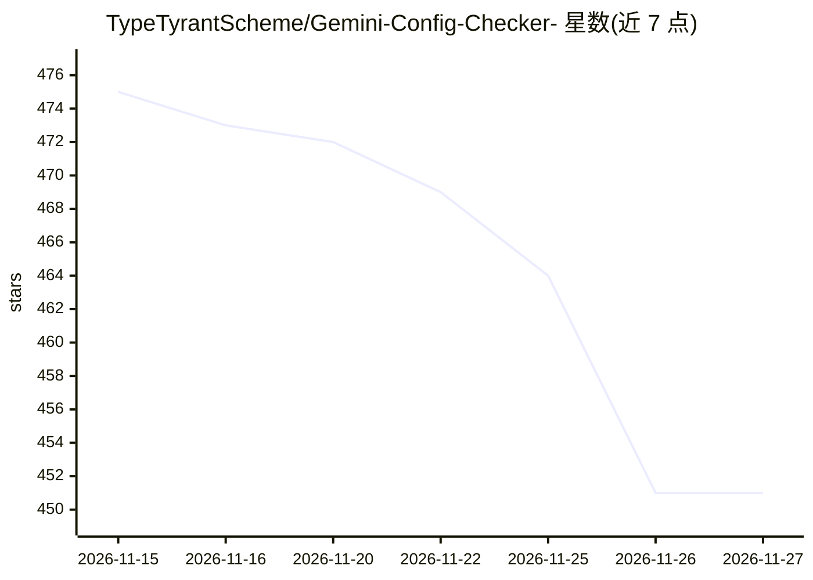

# TypeTyrantScheme/Gemini-Config-Checker-

⭐ 451 · Makefile · Apache-2.0 · 推送 2026-11-15 · [GitHub](https://github.com/TypeTyrantScheme/Gemini-Config-Checker-) · 个人维护

**扫描代理配置能否进入 Google AI Studio 与 Gemini 的桌面/命令行工具**

面向需要经代理访问 Google AI Studio 和 Gemini 的用户：批量测试 vless/vmess/trojan/ss 等配置或订阅链接，以已登录 Google 账号的浏览器读取 Google 的真实区域判定，并支持连通性快速模式。Advanced 模式可将免费配置链在可用基础配置之后以更换出口，内嵌 Xray-core 引擎并提供基于 PattN 配方的抗 DPI 分片转发。以桌面应用（Windows/macOS/Linux/Android APK）和本地 Web 服务端形式发布。macOS/Linux/Android 构建未经真机验证，Web UI 无鉴权需保持 localhost。

## 筛选速览

| 维度 | 判定 | 备注 |
|---|---|---|
| AI 角色 | `ai-enhanced` | 去掉 AI 部分产品仍成立 |
| 许可风险 | `permissive` | Apache-2.0 |
| 部署形态 | `desktop` | 安装包/桌面程序 |
| 模型依赖 | — | README 未给出锁定关系 |
| 硬件要求 | — | 无带数字的原话,不猜 |
| 安装摩擦 | `medium` | 含编译或系统依赖之一 |
| 成熟度 | `idea` | |

## 能力要点

- 两种模式：直接测试自有配置 / 免费配置链在基础配置之后的链式测试
- 以已登录浏览器的独立配置读取 Google 对 AI Studio 与 Gemini 的区域判定
- 可编辑的抗 DPI 配方（fragment 分片、13 组 cipher、ALPN）由本地转发器实现
- 结果可导出链接、base64 与完整/链式 Xray 配置

## 适用场景

- 确认手头的代理配置能否真正打开 Gemini 或 AI Studio
- 在出口被 Google 屏蔽时通过链式免费配置寻找可用出口
- 在受深度包检测影响的网络中为 Cloudflare 配置应用抗 DPI 设置

## 场景标签

 · 领域:网络工具/代理配置检测

## 证据(README 行号)

> L11: Find proxy configs that actually get you into **Google AI Studio and Gemini**, by testing each one the way a person
> L50: Google decides region availability **per signed-in account, after the page has loaded**. A plain HTTP request (even
> L155: |Check type|Region with signed-in browser|**Region**: opens AI Studio and Gemini and reads Google's verdict (accur

## 星数曲线

2026-11-15 475 → 2026-11-27 451（-24）

---
*卡片 v1 · prompt 1.4 · 生成 2026-11-17 · 置信度 high · 依据 README sha `846e83cebb20` · [字段定义](../../DATASET.md)*
