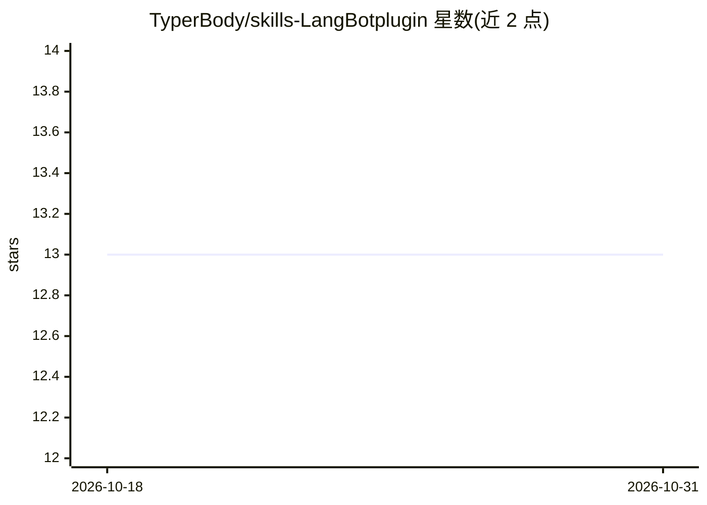

# TyperBody/skills-LangBotplugin

⭐ 13 · MDX · AGPL-3.0 · 推送 2026-10-17 · [GitHub](https://github.com/TyperBody/skills-LangBotplugin) · [官网](https://langbot.app/) · 个人维护 · 中文 README

**LangBot 插件技能的自动生成与调试工具**

面向 LangBot 生态的技能开发工具族，含两个组件：Skills-LangBotPlugin 基于模板自动生成符合 LangBot 规范的 AI 可调用技能，支持 RAG、搜索引擎、外部工具等多源集成，并提供技能调用日志与性能监控；Skills-LangBotPluginDebug 提供实时调试控制台、分步执行检查、错误诊断、性能分析与技能调用回放。README 末尾附插件示例清单（版本/许可/作者/组件），但未给出本产品的具体安装命令。

## 筛选速览

| 维度 | 判定 | 备注 |
|---|---|---|
| AI 角色 | `ai-ecosystem` | LLM/agent 周边工具 |
| 许可风险 | `viral` | AGPL-3.0 |
| 部署形态 | `None` |  |
| 模型依赖 | — | README 未给出锁定关系 |
| 硬件要求 | — | 无带数字的原话,不猜 |
| 安装摩擦 | `low` | 无编译、无系统依赖或容器化 |
| 成熟度 | — | 结构信号不足 |

## 能力要点

- 基于模板自动生成符合 LangBot 规范的技能
- 实时调试控制台与分步执行检查
- 技能调用回放与性能分析
- 支持 RAG、搜索引擎、外部工具等多源集成

## 适用场景

- 为 LangBot 插件快速封装 AI 可调用技能
- 开发中实时监控与诊断技能执行
- 通过示例插件清单了解技能生态

## 场景标签

 · 领域:聊天机器人/插件开发工具

## 证据(README 行号)

> L9: - **Skills-LangBotPlugin** — Automates skill creation and management
> L16: **Skills-LangBotPlugin** is a powerful tool designed to **automatically create and manage skills** for LangBot plug

## 星数曲线

2026-10-18 13 → 2026-10-31 13（+0）

---
*卡片 v1 · prompt 1.4 · 生成 2026-10-31 · 置信度 mid · 依据 README sha `f1380589c704` · [字段定义](../../DATASET.md)*
