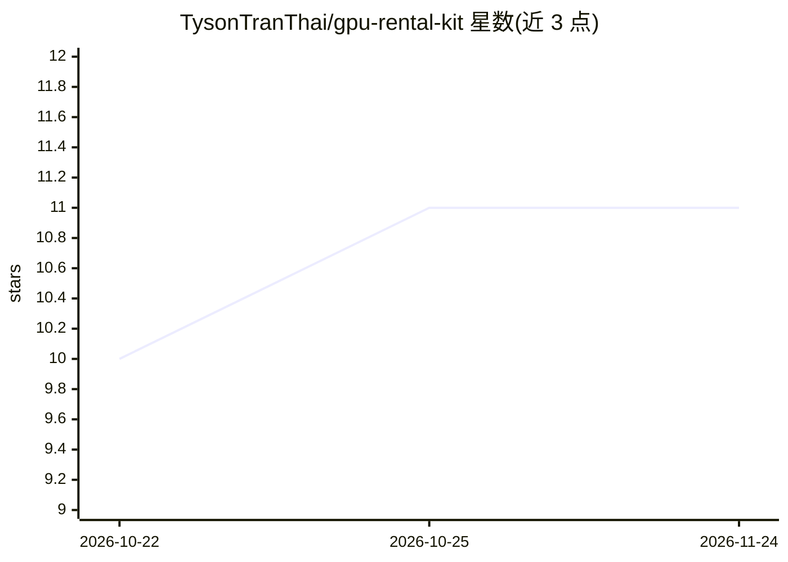

# TysonTranThai/gpu-rental-kit

⭐ 11 · Shell · MIT · 推送 2026-09-23 · [GitHub](https://github.com/TysonTranThai/gpu-rental-kit) · 个人维护

**一键把租用的 NVIDIA GPU 服务器配置为自托管 LLM 推理服务**

面向租用 Linux NVIDIA GPU 虚拟机的 Bash 工具包，自动化完成 GPU 检测与 CUDA 验证、Python 虚拟环境、GPU 版 PyTorch、推理运行时安装、Hugging Face 模型下载与 OpenAI 兼容推理服务器启动，并带备份、日志、健康检查与本地/模拟/远程测试。架构上区分两端：租用的 Linux GPU 服务器运行模型，本地 Mac/Windows/Linux 客户端通过 SSH 隧道连接，本地无需 NVIDIA GPU；服务器端当前仅支持 Linux。安装器首个步骤支持英/越/中三语选择。

## 筛选速览

| 维度 | 判定 | 备注 |
|---|---|---|
| AI 角色 | `ai-ecosystem` | LLM/agent 周边工具 |
| 许可风险 | `permissive` | MIT |
| 部署形态 | `self-host` | docker 或自建部署 |
| 模型依赖 | local-ok | 支持本地模型 |
| 硬件要求 | — | 无带数字的原话,不猜 |
| 安装摩擦 | `low` | 无编译、无系统依赖或容器化 |
| 成熟度 | `idea` | |

## 能力要点

- RENT→INSTALL→TEST→RUN 工作流：GPU 检测、CUDA 验证、环境安装、模型验证
- 支持三种推理运行时：llama.cpp（主运行时）、Ollama、vLLM（可选）
- 本地客户端无需 NVIDIA GPU，通过 SSH 隧道访问服务器上绑定 127.0.0.1 的推理 API
- 可选安装 9Router 与 OmniRoute 两个 OpenAI 兼容 AI 路由

## 适用场景

- 租用 GPU 服务器后一键搭建自托管 LLM 推理服务
- 从 Mac/Windows/Linux 本地机通过 SSH 隧道调用远程模型
- 对租用 GPU 机器做驱动、存储与推理能力的验证测试

## 场景标签

`推理引擎` · 领域:训练与推理

## 证据(README 行号)

> L26: `gpu-rental-kit` automates the setup of a rented Linux NVIDIA GPU machine for local/self-hosted LLM inference. It h
> L32: - Ollama, llama.cpp, and vLLM runtimes
> L40: The project is **provider-agnostic**: the provider can be any service that gives you SSH access to a Linux machine 

## 星数曲线

2026-10-22 10 → 2026-11-24 11（+1）

---
*卡片 v1 · prompt 1.4 · 生成 2026-11-18 · 置信度 mid · 依据 README sha `4c367dafee26` · [字段定义](../../DATASET.md)*
