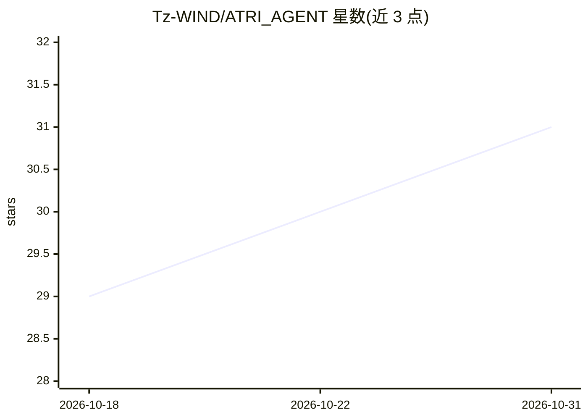

# Tz-WIND/ATRI_AGENT

⭐ 31 · Python · AGPL-3.0 · 推送 2026-08-20 · [GitHub](https://github.com/Tz-WIND/ATRI_AGENT) · 组织维护 · 中文 README

**本地优先 AI Agent 运行时 + Agent 可直接操作的 DAW 音乐工作站**

ATRI 首先提供可本地运行的多 Provider Agent Runtime：OpenAI 兼容 / Anthropic 接入、工具调用、Plan / Agent / DeepResearch 三种模式、会话持久化、MCP、Skills、Knowledge（向量检索 + 可选 Neo4j 图谱）、Web 搜索，以及 WebChat / OneBot11 / VST3 Bridge 接入。在此之上内置 Agent 原生 DAW：Agent 通过 midi_write / midi_diff 等工具直接读写工程的 MIDI、CC、自动化数据，结果落为可继续编辑的工程文件。架构上由 Python Runtime、Vue Dashboard 与基于 CPAL 的 Rust Audio Host（含 VST3 加载与播放）围绕同一 project.json 协作。安装需从源码构建，依赖 Python 3.11+ / uv / Node.js 18+ / Rust 工具链。

## 筛选速览

| 维度 | 判定 | 备注 |
|---|---|---|
| AI 角色 | `ai-native` | 本体是模型或模型工具 |
| 许可风险 | `viral` | AGPL-3.0 |
| 部署形态 | `None` |  |
| 模型依赖 | — | README 未给出锁定关系 |
| 硬件要求 | — | 无带数字的原话,不猜 |
| 安装摩擦 | `medium` | 含编译或系统依赖之一 |
| 成熟度 | — | 结构信号不足 |

## 能力要点

- 多 Provider Agent Runtime：工具调用、Plan / Agent / DeepResearch 模式、MCP / Skills / Knowledge
- Agent 通过 midi_write / midi_diff / midi_batch_edit 等工具直接读写 DAW 工程（symbolic first，非波形生成）
- Rust Audio Host（CPAL + VST3 加载）与 ATRI Bridge VST3 插件可嵌入 Studio One 等宿主 DAW
- 带证据账本的 DeepResearch：共享预算、稳定引用 [R]/[G]/[W] 与来源清单

## 适用场景

- 把 ATRI 当本地 coding agent 使用：读写文件、跑终端、管理 workspace
- 在 DAW 工程内让 Agent 写 bassline、画 CC 曲线、批量编辑 velocity 后继续手工修改
- 通过 QQ（OneBot11）或宿主 DAW 内的 VST3 插件与 Agent 对话协作
- 用 Knowledge + Neo4j 图谱做带证据溯源的本地深度研究

## 场景标签

`Agent 框架` · 领域:Agent 开发

## 证据(README 行号)

> L5: ATRI 首先是一个可本地运行的 **AI Agent Runtime**：多 Provider LLM、工具调用、Plan / Agent / DeepResearch 模式、会话持久化、子任务、MCP、Skills、知识库、We
> L7: 在此之上，ATRI 又是一个 **Agent 原生音乐工作站**。它尝试的是一条和「输入提示词，生成一段完整音频」完全不同的 AI 音乐路线：让同一个 Agent 进入 DAW 工程内部，读取时间线、轨道、clip、和声标记、MID
> L30: - **完整的本地 Agent Runtime**

## 星数曲线

2026-10-18 29 → 2026-10-31 31（+2）

---
*卡片 v1 · prompt 1.4 · 生成 2026-10-26 · 置信度 high · 依据 README sha `03f0f9a57524` · [字段定义](../../DATASET.md)*
