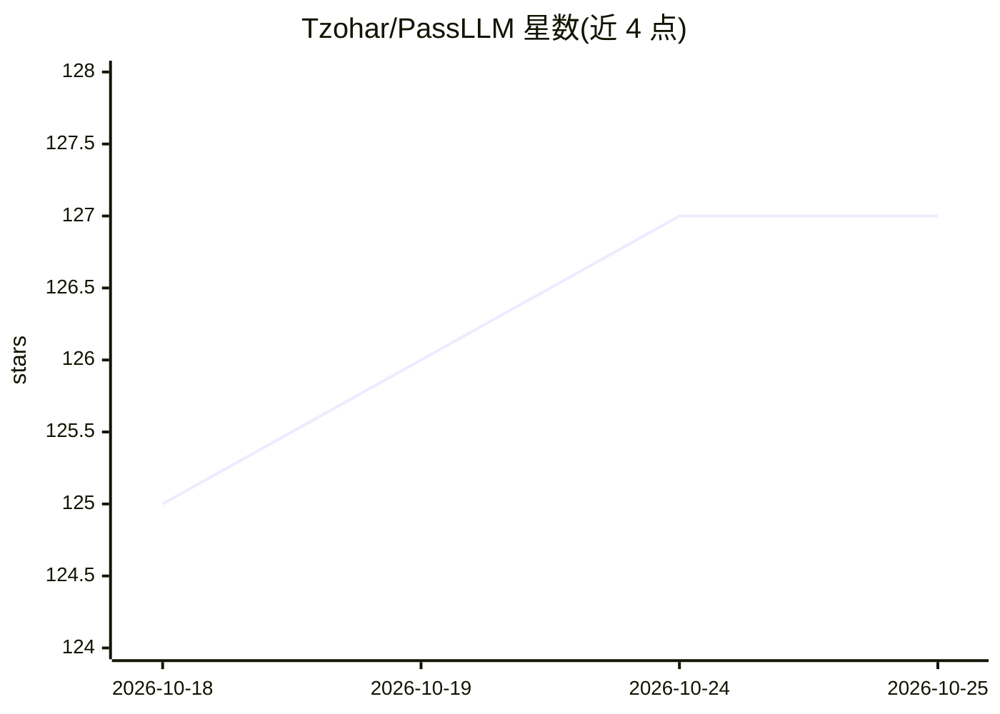

# Tzohar/PassLLM

⭐ 127 · Python · GPL-3.0 · 推送 2026-07-29 · [GitHub](https://github.com/Tzohar/PassLLM) · 个人维护

**基于 LLM 的定向密码猜测框架，用 PII 生成目标候选密码**

USENIX Security 2025 论文《Password Guessing Using Large Language Models》的非官方 PyTorch 复现：以姓名、生日、邮箱、旧密码等 PII 为输入，通过 LoRA 微调的 7B/4B LLM（Mistral/Qwen 底座）生成按概率排序的候选密码。提供预训练权重（约 126MB）、WebUI 与 CLI 两种使用方式，推理可在任意 GPU 或 CPU 上运行，训练需 NVIDIA CUDA GPU。仓库声明仅供教育与安全研究用途，项目当前暂时搁置中。

## 筛选速览

| 维度 | 判定 | 备注 |
|---|---|---|
| AI 角色 | `ai-native` | 本体是模型或模型工具 |
| 许可风险 | `viral` | GPL-3.0 |
| 部署形态 | `None` |  |
| 模型依赖 | — | README 未给出锁定关系 |
| 硬件要求 | — | 无带数字的原话,不猜 |
| 安装摩擦 | `medium` | 含编译或系统依赖之一 |
| 成熟度 | — | 结构信号不足 |

## 能力要点

- LoRA 微调 Mistral/Qwen 7B/4B 模型，降低显存占用
- 输入目标 PII（姓名/生日/邮箱/旧密码等）生成排序候选密码
- 提供 WebUI 与 CLI 两种推理方式及预训练权重
- 支持在自有 PII-密码对数据集上训练

## 适用场景

- 安全研究：评估 LLM 驱动的定向密码攻击风险
- 授权渗透测试中针对特定目标的密码猜测
- 复现论文结果或在新泄露数据集上训练模型

## 场景标签

`网络安全` · 领域:学习与行业

## 证据(README 行号)

> L11: **PassLLM is the world's most accurate targeted password guessing framework**, outperforming other models by 15% to
> L12: The model fine-tunes 7B/4B parameter LLMs on millions of leaked PII records using LoRA, enabling a private, high-ac
> L18: * **State-of-the-Art Accuracy:** Achieves **+45% higher success rates** than leading benchmarks (RankGuess, TarGues

## 星数曲线

2026-10-18 125 → 2026-10-25 127（+2）

---
*卡片 v1 · prompt 1.4 · 生成 2026-10-23 · 置信度 high · 依据 README sha `65985ab96fd4` · [字段定义](../../DATASET.md)*
