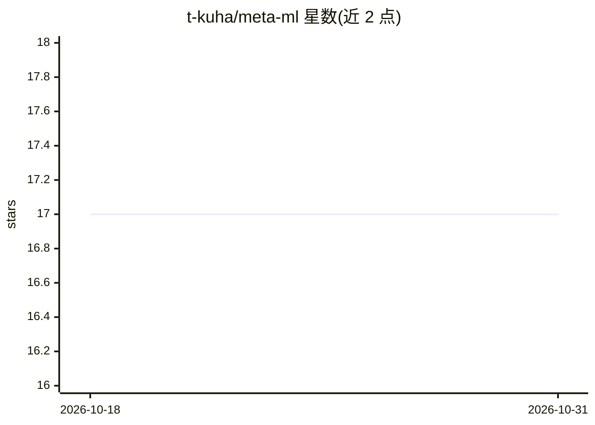

# t-kuha/meta-ml

⭐ 17 · BitBake · 推送 2026-02-06 · [GitHub](https://github.com/t-kuha/meta-ml) · 个人维护

**为 Zynq 嵌入式设备提供机器学习库的 Yocto 配方层**

一个 Yocto/OpenEmbedded meta 层（Scarthgap 5.0.4），为 ARM Zynq-7000 与 Zynq MPSoC 设备打包机器学习库的 bitbake 配方，收录 ARM ComputeLibrary（v52.7.0 及多个历史版本）、ARM NN（25.11 及多个版本）、ExecuTorch v1.0.1 和指定 commit 的 llama.cpp。PyTorch 配方已删除，因 aarch64 wheel 可直接从 PyPI 获取。面向使用 Yocto 构建嵌入式 Linux 镜像的开发者。

## 筛选速览

| 维度 | 判定 | 备注 |
|---|---|---|
| AI 角色 | `ai-ecosystem` | LLM/agent 周边工具 |
| 许可风险 | `none` | — |
| 部署形态 | `library` | 以包/库形式分发 |
| 模型依赖 | — | README 未给出锁定关系 |
| 硬件要求 | — | 无带数字的原话,不猜 |
| 安装摩擦 | `low` | 无编译、无系统依赖或容器化 |
| 成熟度 | — | 结构信号不足 |

## 能力要点

- 提供 ARM ComputeLibrary / ARM NN / ExecuTorch / llama.cpp 的 bitbake 配方
- 面向 Zynq-7000 与 Zynq MPSoC (aarch64) 设备
- 基于 Yocto Scarthgap 5.0.4

## 适用场景

- 在 Zynq 嵌入式 Linux 镜像中集成机器学习推理库
- 为 ARM 嵌入式设备构建带 ML 库的系统镜像

## 场景标签

 · 领域:嵌入式/ML 基础设施

## 证据(README 行号)

> L3: - Yocto recipes for machine learning libraries
> L8: - __ARM ComputeLibrary (ACL)__: v52.7.0 (25.03, 24.06, 23.08)
> L11: - __llama.cpp__: llama.cpp (commit: 37c35f0)

## 星数曲线

2026-10-18 17 → 2026-10-31 17（+0）

---
*卡片 v1 · prompt 1.4 · 生成 2026-10-29 · 置信度 mid · 依据 README sha `26065a798389` · [字段定义](../../DATASET.md)*
