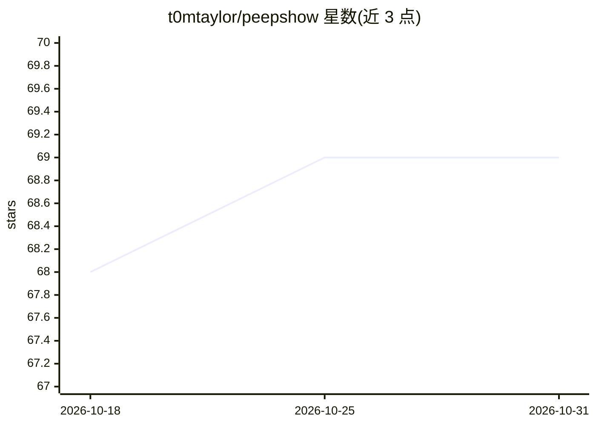

# t0mtaylor/peepshow

⭐ 69 · JavaScript · MIT · 推送 2026-10-10 · [GitHub](https://github.com/t0mtaylor/peepshow) · 个人维护

**把视频/动图抽成帧时间轴与音频转录，供 LLM 查看**

面向 LLM CLI 与编码 agent 的视频预处理工具：用 ffmpeg 将视频或 GIF/APNG/WebP 抽成静态帧时间轴（场景变化检测、dHash 感知去重、自适应密度），并提取音轨、可选转录（默认本地 whisper.cpp base.en，亦可切 openai/groq/deepgram/assemblyai/cloud）。输出 JSON manifest，可经 95 个内置 sink 后端分发到向量库、SQL、聊天、笔记等系统。提供 Claude Code 插件（拖拽即触发 UserPromptSubmit hook）、Cursor/Windsurf/Cline/Codex/Gemini CLI 集成及独立 shell 用法。要求 Node ≥ 22，依赖 ffmpeg；默认发送匿名遥测，可关闭。

## 筛选速览

| 维度 | 判定 | 备注 |
|---|---|---|
| AI 角色 | `ai-ecosystem` | LLM/agent 周边工具 |
| 许可风险 | `permissive` | MIT |
| 部署形态 | `desktop` | 安装包/桌面程序 |
| 模型依赖 | locked-api |  |
| 硬件要求 | — | 无带数字的原话,不猜 |
| 安装摩擦 | `medium` | 含编译或系统依赖之一 |
| 成熟度 | — | 结构信号不足 |

## 能力要点

- 场景变化检测 + dHash 感知去重的抽帧管线
- 音轨提取与本地 whisper.cpp 转录（无 API key、不出机器）
- 95 个内置可插拔 sink 后端（SQL/向量库/聊天/笔记/工单等）
- 8+ 种 agent 工具的原生清单集成与拖拽式 Claude Code 体验

## 适用场景

- 在 Claude Code 等 agent 中直接拖入视频让其'观看'并回答
- 把视频抽帧+转录结果归档到向量库或笔记系统供检索
- 服务端一次抽取、多模型复用，降低上传带宽与 token 成本

## 场景标签

`图像视频处理` `语音识别` · 领域:感知与多模态

## 证据(README 行号)

> L16: > **video → frames → LLM.** Any LLM CLI. Any storage backend. Zero glue code.
> L22: Static images (JPG, PNG, static WebP) are already handled natively by most LLMs — drag, drop, done. **`peepshow` on
> L87: `peepshow` is a CLI first — anything that can spawn a child process can use it. The intended use cases break down l

## 星数曲线

2026-10-18 68 → 2026-10-31 69（+1）

---
*卡片 v1 · prompt 1.4 · 生成 2026-10-24 · 置信度 high · 依据 README sha `20343fcaa68e` · [字段定义](../../DATASET.md)*
