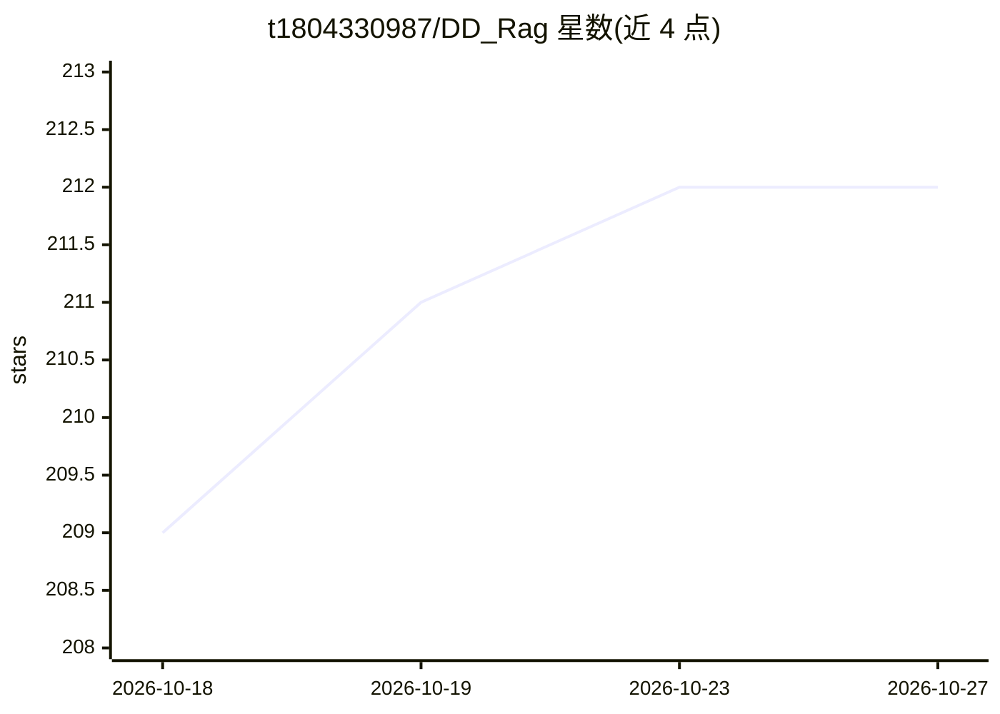

# t1804330987/DD_Rag

⭐ 212 · Java · 推送 2026-07-15 · [GitHub](https://github.com/t1804330987/DD_Rag) · 个人维护 · 中文 README

**面向组织知识库的全栈 RAG 与 AI 助手项目（Java/Vue）**

基于 Spring AI / Spring AI Alibaba 的全栈 RAG 工程闭环：组织与组内双层权限隔离，文档上传、解析、切片、异步入库的全生命周期管理，PgVector 语义召回与 Elasticsearch 关键词召回经 RRF 融合后做证据约束问答；Assistant 支持多轮会话、流式响应、短期记忆摘要与 KB_SEARCH 工具调用。V6.1 起模型连接与调用治理在应用内配置（平台共享模型与用户 BYOK）。部署方式仅保留单机 Docker Compose，包含 PostgreSQL、Elasticsearch、MinIO、Ollama 等全套服务；README 声明当前以单机自托管验证为目标，生产级高可用需另行设计。

## 筛选速览

| 维度 | 判定 | 备注 |
|---|---|---|
| AI 角色 | `ai-native` | 本体是模型或模型工具 |
| 许可风险 | `none` | — |
| 部署形态 | `self-host` | docker 或自建部署 |
| 模型依赖 | local-ok | 支持本地模型 |
| 硬件要求 | — | 无带数字的原话,不猜 |
| 安装摩擦 | `low` | 无编译、无系统依赖或容器化 |
| 成熟度 | — | 结构信号不足 |

## 能力要点

- PgVector 语义召回 + Elasticsearch 关键词召回 + RRF 融合的证据约束问答
- 系统角色与组内角色双层权限隔离
- V6.1 应用内模型平台：平台共享模型、用户 BYOK、场景路由与调用账本
- 单机 Docker Compose 一键启动全套依赖服务

## 适用场景

- 在组织内搭建带权限隔离的知识库问答系统
- 学习 Spring AI / Spring AI Alibaba 的 RAG 与 Agent 工程实现
- 自托管一套含文档入库、混合检索与模型治理的完整链路

## 场景标签

`RAG` `文档问答` · 领域:知识与检索

## 证据(README 行号)

> L3: DD_Rag 是一个面向组织知识库的全栈 RAG 与 AI 助手项目。它将用户与组权限、文档生命周期、混合检索、证据约束问答、会话式 Agent 和模型治理组合为一条可运行的工程闭环。
> L15: - 混合检索问答：PgVector 语义召回、Elasticsearch 关键词召回、RRF 融合和证据约束回答。
> L16: - Assistant：多轮会话、流式响应、短期记忆摘要与 `KB_SEARCH` 工具调用。

## 星数曲线

2026-10-18 209 → 2026-10-27 212（+3）

---
*卡片 v1 · prompt 1.4 · 生成 2026-10-22 · 置信度 high · 依据 README sha `21a47af29edd` · [字段定义](../../DATASET.md)*
