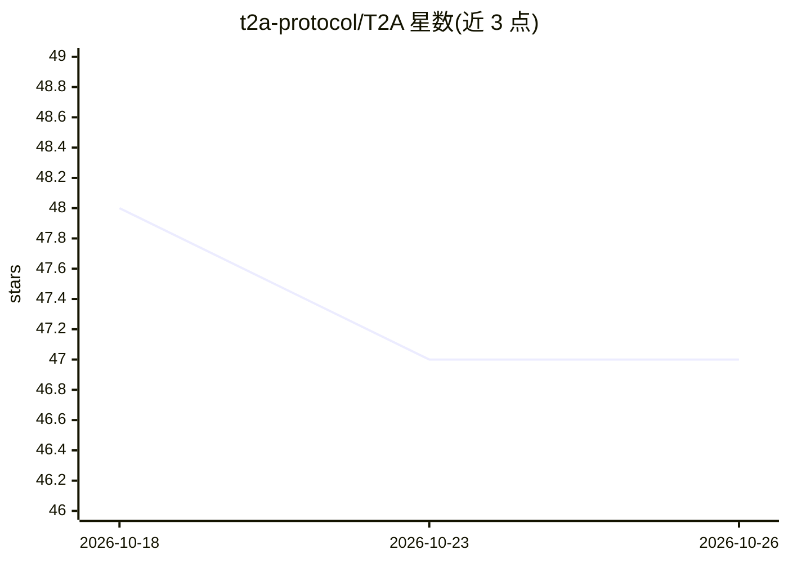

# t2a-protocol/T2A

⭐ 47 · TypeScript · Apache-2.0 · 推送 2026-07-22 · [GitHub](https://github.com/t2a-protocol/T2A) · 组织维护

**工具向宿主 agent 交还推理检查点的协议与首个记忆工具证明**

T2A（Tool-to-Agent Protocol）定义一种可审计的推理移交机制：工具在到达推理检查点时不内嵌 LLM 调用，而是发出 T2A Capsule（含 task.json、prompt、output schema），由宿主 agent（如 Codex、Claude Code、Cursor）完成推理并写回结构化输出，工具校验后再提交状态并恢复工作流。首个实现 t2a-memory 是本地记忆工具，不需要模型 key、provider 配置或本地模型。面向工具作者与宿主 agent 开发者，通过 npm 安装，支持 CLI/API/SDK/CI/MCP 多种载体；协议定位与 MCP、A2A 互补而非替代，capsule 在 v0.1 为本地文件形式。

## 筛选速览

| 维度 | 判定 | 备注 |
|---|---|---|
| AI 角色 | `ai-ecosystem` | LLM/agent 周边工具 |
| 许可风险 | `permissive` | Apache-2.0 |
| 部署形态 | `library` | 以包/库形式分发 |
| 模型依赖 | — | README 未给出锁定关系 |
| 硬件要求 | — | 无带数字的原话,不猜 |
| 安装摩擦 | `low` | 无编译、无系统依赖或容器化 |
| 成熟度 | — | 结构信号不足 |

## 能力要点

- 工具发出含 prompt 与 output schema 的 T2A Capsule，宿主 agent 完成推理
- t2a-memory 本地记忆工具：无需模型 key、provider 配置或工具侧本地模型
- 提供 CLI 校验/提交流程（t2a validate、t2a-memory commit）
- 可向 .agents/.claude 等目录安装复用 agent 技能文件

## 适用场景

- 我想让工具借用宿主 agent 的推理能力，而不给每个工具配模型 key
- 我想为本地 agent 配一个无模型依赖的记忆工具
- 我在设计 CLI/CI/MCP 工具，想让推理检查点以可审计方式交回 agent

## 场景标签

`Agent 记忆` `Agent 框架` · 领域:Agent 开发

## 证据(README 行号)

> L11:  T2A is the Tool-to-Agent Protocol for auditable reasoning handoffs.
> L43: The tool emits a structured, auditable reasoning handoff. The host agent completes the reasoning with its existing 
> L312: |T2A|Tool -> Agent|Tools hand off reasoning checkpoints|

## 星数曲线

2026-10-18 48 → 2026-10-26 47（-1）

---
*卡片 v1 · prompt 1.4 · 生成 2026-10-25 · 置信度 high · 依据 README sha `cb795a788e07` · [字段定义](../../DATASET.md)*
