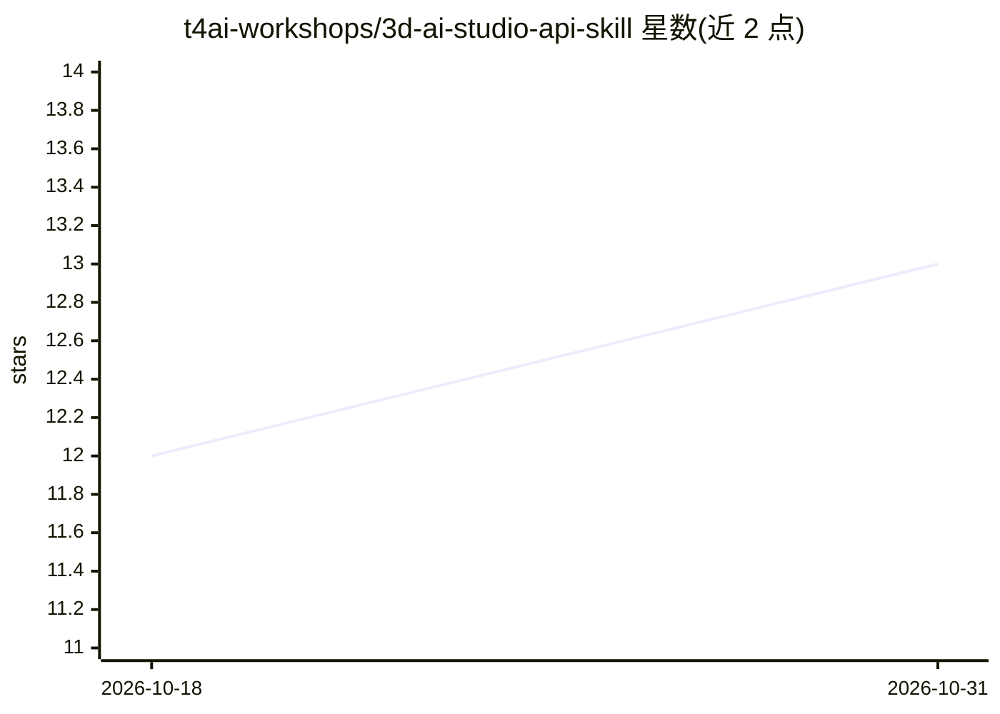

# t4ai-workshops/3d-ai-studio-api-skill

⭐ 13 · Python · 推送 2026-07-27 · [GitHub](https://github.com/t4ai-workshops/3d-ai-studio-api-skill) · [官网](https://www.3daistudio.com/Platform) · 组织维护

**让 Claude/Hermes 等 agent 调用 3D AI Studio API 生成 3D 模型与图像的技能**

面向 agent 框架（Claude Code、Cursor、Codex、Hermes 等）的 API 技能包：通过 3D AI Studio 云端 API 提供 text/image-to-3D（腾讯混元 Rapid/Pro、TRELLIS.2、Tripo v3/P1）、AI 图像生成（Gemini 系列、SeeDream）、3D 格式转换/渲染/网格修复/贴图烘焙，以及照片转 3D 打印手办流程。所有操作异步（task_id 轮询），按 credits 计费（预付、365 天有效、失败自动退款），默认限速 3 请求/分钟。需自配 API key 并安装 Python 依赖。

## 筛选速览

| 维度 | 判定 | 备注 |
|---|---|---|
| AI 角色 | `ai-ecosystem` | LLM/agent 周边工具 |
| 许可风险 | `none` | — |
| 部署形态 | `library` | 以包/库形式分发 |
| 模型依赖 | — | README 未给出锁定关系 |
| 硬件要求 | — | 无带数字的原话,不猜 |
| 安装摩擦 | `low` | 无编译、无系统依赖或容器化 |
| 成熟度 | — | 结构信号不足 |

## 能力要点

- text/image-to-3D：腾讯混元 Rapid/Pro、TRELLIS.2、Tripo v3/P1
- 图像生成：Gemini 3 Pro / 3.1 Flash / 2.5 Flash、SeeDream v5 Lite
- 3D 工具：格式转换、渲染、网格修复、优化、贴图烘焙、体积计算
- 照片转 3D 可打印手办流程（miniature，200–300 credits）

## 适用场景

- 在 Claude 等 agent 中用自然语言生成 3D 模型与图像
- 对已有 3D 模型做转换、修复、烘焙与优化处理
- 把照片变成可 3D 打印的手办模型

## 场景标签

`图像生成` · 领域:内容生成

## 证据(README 行号)

> L16: An agent skill for the 3D AI Studio API. Gives Claude and Hermes agents programmatic access to 3D model generation,
> L20: - **3D Generation** — text-to-3D and image-to-3D via Tencent Hunyuan (Rapid & Pro), TRELLIS.2, Tripo v3, and Tripo 

## 星数曲线

2026-10-18 12 → 2026-10-31 13（+1）

---
*卡片 v1 · prompt 1.4 · 生成 2026-10-31 · 置信度 mid · 依据 README sha `81ce7b96b635` · [字段定义](../../DATASET.md)*
