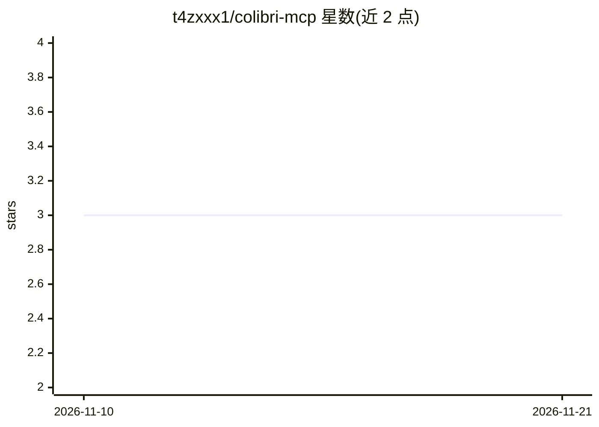

# t4zxxx1/colibri-mcp

⭐ 3 · JavaScript · MIT · 推送 2026-11-10 · [GitHub](https://github.com/t4zxxx1/colibri-mcp) · [官网](https://github.com/t4zxxx1/colibri-mcp#readme) · 个人维护

**为 AI agent 提供网页浏览的 MCP 服务器：页面转紧凑文本**

一个 MCP 服务器，将 Chrome/Edge 中打开的网页压缩为几百 token 的行式文本（字段、值、状态、风险标志）供 AI agent 读取，替代截图或无障碍树转储。提供 browse_open/browse_search/browse_do/browse_task 等工具，单次调用最多执行 40 步，仅返回变更差异；表单填写由本地 Jev 风格引擎完成，无需 API key。需要 Node.js ≥18 与 Chrome 或 Edge，通过 npx 或源码运行。

## 筛选速览

| 维度 | 判定 | 备注 |
|---|---|---|
| AI 角色 | `ai-ecosystem` | LLM/agent 周边工具 |
| 许可风险 | `permissive` | MIT |
| 部署形态 | `library` | 以包/库形式分发 |
| 模型依赖 | — | README 未给出锁定关系 |
| 硬件要求 | — | 无带数字的原话,不猜 |
| 安装摩擦 | `low` | 无编译、无系统依赖或容器化 |
| 成熟度 | — | 结构信号不足 |

## 能力要点

- 页面转为紧凑行式文本，声称较截图减少约 89 倍 token
- browse_do 单次调用最多 40 步，仅返回变更差异
- 本地 Jev 风格表单引擎，无需 API key
- 提交/支付/删除需用户确认，密码/卡号/OTP 不由 AI 输入

## 适用场景

- 让 Claude Code、Cursor 等 agent 自主浏览网页并填写表单
- agent 读取列表页并进入详情页提取表格数据
- 在浏览器中代为完成多字段申请流程

## 场景标签

`浏览器自动化` · 领域:效率与自动化

## 证据(README 行号)

> L7: MCP
> L36: **Colibri** turns each page into a few hundred tokens of plain rows — fields, values, state, risk flags — runs **ma
> L207: 2. **Many steps, one call.** `browse_do` runs up to 40 steps (fill, select, check, click, wait, read) and keeps go

## 星数曲线

2026-11-10 3 → 2026-11-21 3（+0）

---
*卡片 v1 · prompt 1.4 · 生成 2026-11-21 · 置信度 high · 依据 README sha `42f4a5ef1069` · [字段定义](../../DATASET.md)*
