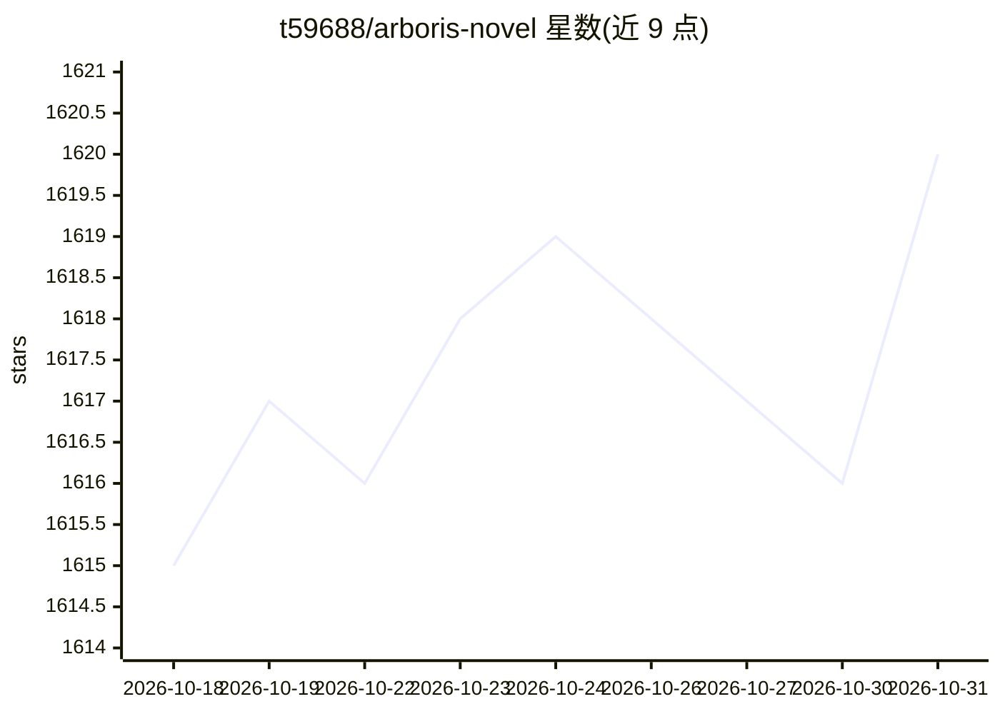

# t59688/arboris-novel

⭐ 1,620 · Python · 推送 2026-02-25 · [GitHub](https://github.com/t59688/arboris-novel) · [官网](https://arboris.aozhiai.com) · 个人维护 · 中文 README

**面向创作者的开源 AI 小说写作辅助 Web 应用**

Arboris-Novel 是一个自托管的开源写作辅助工具：集中管理角色、地点、派系等设定，支持将零散灵感交给 AI 生成主线大纲、AI 出草稿与续写、一次生成多版本内容供挑选。后端 Python/FastAPI，前端 Vue，默认 SQLite 也可用 MySQL，通过 Docker Compose 部署，需配置 OpenAI 或兼容接口的 API Key（服务端 .env 保管）。提供在线体验站点，支持用户注册与每日请求配额等管理员配置。

## 筛选速览

| 维度 | 判定 | 备注 |
|---|---|---|
| AI 角色 | `ai-native` | 本体是模型或模型工具 |
| 许可风险 | `permissive` | — |
| 部署形态 | `self-host` | docker 或自建部署 |
| 模型依赖 | — | README 未给出锁定关系 |
| 硬件要求 | — | 无带数字的原话,不猜 |
| 安装摩擦 | `low` | 无编译、无系统依赖或容器化 |
| 成熟度 | — | 结构信号不足 |

## 能力要点

- 角色/地点/派系设定集中管理，避免前后矛盾
- AI 梳理灵感生成主线大纲、草稿与续写
- 一次生成多版本内容供挑选
- OpenAI API 或任意兼容接口，默认 gpt-3.5-turbo

## 适用场景

- 写长篇小说时集中管理世界观与角色设定
- 卡文时让 AI 出草稿或续写获取灵感
- 把零散场景和灵感整理成主线大纲
- 自部署给写作小组使用并控制配额

## 场景标签

`AI 写作` `知识库管理` · 领域:内容生成

## 证据(README 行号)

> L12: 写作时容易卡在「主角叫什么」「故事发生在哪」「下一章写什么」这类问题上。**Arboris** 在需要时帮你理清思路、记录设定、给出可选方向，让想法落成故事。
> L37: ### 写作辅助
> L45: 目标是做一个**能记住你的世界、理解角色、随故事推进的写作伙伴**，而不是单纯的自动生成器。因此做了 Arboris 并选择开源，方便更多创作者使用。

## 星数曲线

2026-10-18 1,615 → 2026-10-31 1,620（+5）

---
*卡片 v1 · prompt 1.4 · 生成 2026-10-21 · 置信度 mid · 依据 README sha `3205c7b1e394` · [字段定义](../../DATASET.md)*
