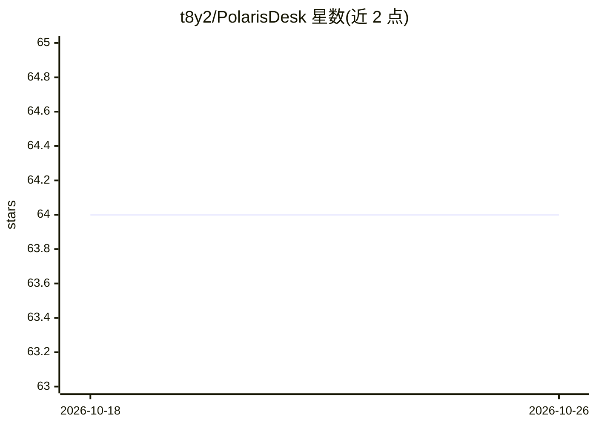

# t8y2/PolarisDesk

⭐ 64 · TypeScript · MIT · 推送 2026-01-02 · [GitHub](https://github.com/t8y2/PolarisDesk) · [官网](https://t8y2.github.io/PolarisDesk/) · 个人维护 · 中文 README

**AI 桌面助手：多模型对话、文档处理与 AI 命令行**

基于 Electron、Vue 与 TypeScript 构建的桌面 AI 助手应用，面向日常办公用户。功能包括多模型 AI 对话（支持 OpenAI、Anthropic、Google、DeepSeek、Ollama 等服务商及 OpenAI API 格式兼容服务）、人设预设切换、AI 驱动的系统命令执行、PDF/PPT/Word 文档解析、截图工具、macOS 下的窗口 UI 树捕获与悬浮聊天窗口，界面支持中英文切换。安装方式为从 Releases 页面下载安装包，或通过 git clone 从源码构建。

## 筛选速览

| 维度 | 判定 | 备注 |
|---|---|---|
| AI 角色 | `ai-native` | 本体是模型或模型工具 |
| 许可风险 | `permissive` | MIT |
| 部署形态 | `None` |  |
| 模型依赖 | local-ok | 支持本地模型 |
| 硬件要求 | — | 无带数字的原话,不猜 |
| 安装摩擦 | `low` | 无编译、无系统依赖或容器化 |
| 成熟度 | — | 结构信号不足 |

## 能力要点

- 多模型 AI 对话，支持自定义 OpenAI API 格式兼容服务
- AI 驱动命令行：由 AI 理解意图并执行系统命令
- 智能文档处理（PDF/PPT/Word）与截图功能
- macOS 下 UI 树感知与悬浮聊天窗口

## 适用场景

- 在桌面端与多家 AI 服务商模型对话并切换人设
- 让 AI 解析 PDF/PPT/Word 文档
- 通过自然语言让 AI 执行系统命令

## 场景标签

`AI 助手` `文档解析` `聊天机器人` · 领域:对话与助手

## 证据(README 行号)

> L16: PolarisDesk（北极星桌面）寓意如同北极星为航海者指引方向一样，为你的日常工作提供智能指引和辅助。这是一款 **AI 驱动**的桌面助手应用，无论是文档处理、代码编写还是问题解答，PolarisDesk 都能成为你可靠的智
> L43: - 🤖 **多模型 AI 对话** - 支持 OpenAI、Anthropic、Google、DeepSeek 等主流 AI 服务

## 星数曲线

2026-10-18 64 → 2026-10-26 64（+0）

---
*卡片 v1 · prompt 1.4 · 生成 2026-10-24 · 置信度 high · 依据 README sha `bde354cb2828` · [字段定义](../../DATASET.md)*
