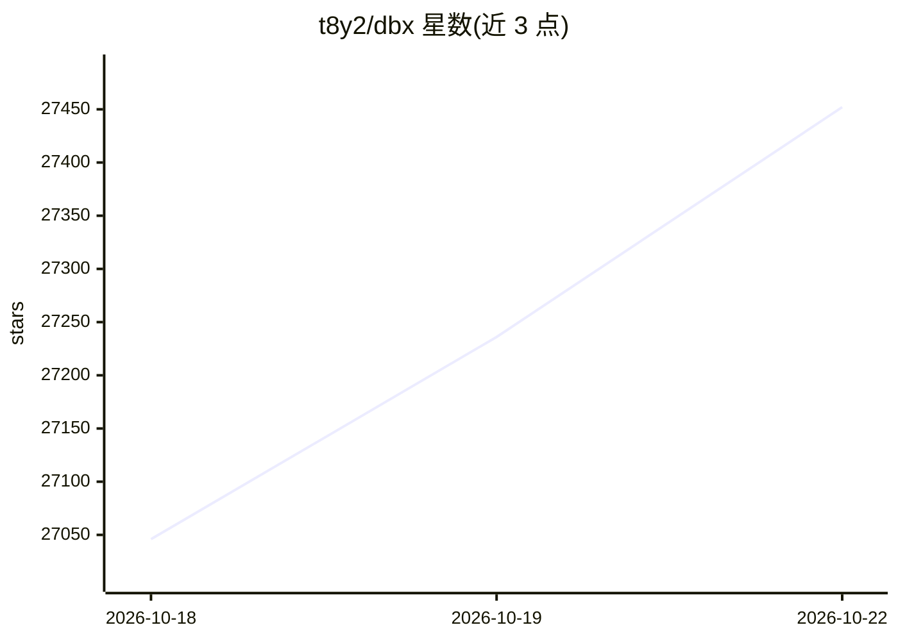

# t8y2/dbx

⭐ 27,555 · Rust · Apache-2.0 · 推送 2026-10-22 · [GitHub](https://github.com/t8y2/dbx) · [官网](https://dbxio.com) · 组织维护 · 中文 README

**给开发者的 25MB 跨平台数据库管理客户端，支持 100+ 数据库**

用 Rust 构建的轻量级开源数据库管理工具，单个约 25MB 二进制文件，无 JRE/Python/Chromium 依赖，提供 macOS、Windows、Linux 桌面端、Docker/Web 部署与 CLI。支持 100+ 数据库连接（含国产数据库达梦、人大金仓等）及消息队列/中间件控制台。内置 AI SQL 助手支持自然语言生成 SQL、解释与优化，并独立分发 MCP Server 供 AI 编码代理查询数据库，权限分 read_only/safe_write/high_risk_write 三档。另有签名沙箱插件商店与 Go/TypeScript SDK。

## 筛选速览

| 维度 | 判定 | 备注 |
|---|---|---|
| AI 角色 | `ai-enhanced` | 去掉 AI 部分产品仍成立 |
| 许可风险 | `permissive` | Apache-2.0 |
| 部署形态 | `desktop` | 安装包/桌面程序 |
| 模型依赖 | local-ok | 支持本地模型 |
| 硬件要求 | — | 无带数字的原话,不猜 |
| 安装摩擦 | `low` | 无编译、无系统依赖或容器化 |
| 成熟度 | — | 结构信号不足 |

## 动量与使用信号

- 维护:`active` — 距上次 push 0.7 天,年发版 100,364 位贡献者
- 涨星:近 1 天 **+123**(自 20261016 起算)
- 安装:npm 包 `@dbx-app/mcp-server` 月下载 45,076
- 平台:— · 协议:OPENAI-API / MCP / OLLAMA

## 能力要点

- 单二进制约 25MB，无 JRE、Python venv、Chromium 依赖
- 内置 AI SQL 助手，支持 Claude、OpenAI、本地模型及 OpenAI 兼容端点，AI 生成 SQL 经内置安全检查
- 独立分发的 Rust MCP Server，供 Claude Code、Cursor 等 AI 代理通过已配置连接查询数据库
- 支持消息队列与中间件控制台：Kafka、RocketMQ、RabbitMQ、Pulsar、MQTT、Nacos 等

## 适用场景

- 用一个客户端管理 MySQL、PostgreSQL、Redis、MongoDB 等多种数据库连接
- 通过自然语言生成并检查 SQL，减少在工具间复制粘贴
- 自托管 Docker/Web 版本供团队统一访问数据库
- 让 Claude Code/Cursor 等 AI 编码代理安全地查询已有数据库连接

## 场景标签

`代码生成` · 领域:编码与开发

## 证据(README 行号)

> L1: 100+ databases in 25 MB. Desktop, Docker, CLI, built-in AI assistant, and MCP Server.
> L128:  Highlight a table, describe what you want, get SQL back — no copy-paste between tools. Works with Claude, OpenAI,
> L208: DBX provides a separate Rust-powered MCP server that lets AI coding agents query databases using connections confi

## 星数曲线

2026-10-18 27,046 → 2026-10-22 27,452（+406）

---
*卡片 v1 · prompt 1.4 · 生成 2026-10-18 · 置信度 high · 依据 README sha `61a1cb96968f` · [字段定义](../../DATASET.md)*
