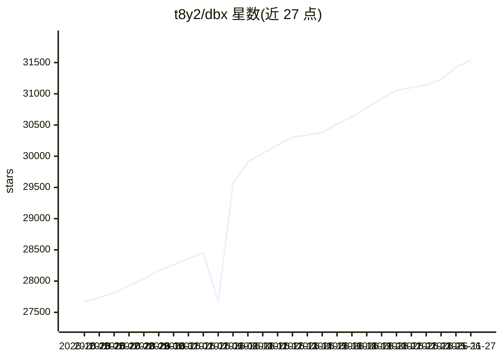

# t8y2/dbx

⭐ 31,537 · Rust · Apache-2.0 · 推送 2026-11-26 · [GitHub](https://github.com/t8y2/dbx) · [官网](https://dbxio.com) · 个人维护 · 中文 README

**面向开发者/DBA 的 25MB 跨平台数据库管理客户端**

用 Rust 构建的数据库管理工具，单个约 25 MB 二进制文件，无 JRE/Python/Chromium 依赖，支持 MySQL、PostgreSQL、达梦等 100+ 数据库及 Kafka 等消息队列中间件控制台。功能包括查询编辑器、数据网格、模式工具、数据导入迁移、插件商店。内置 AI 助手可将自然语言转 SQL 并做安全检查；独立的 MCP Server 让 Claude Code、Cursor 等 agent 经 DBX 连接查询数据库，支持只读/读写/完全访问三级权限模式。提供桌面端、Docker、CLI、Web 多种形态。

## 筛选速览

| 维度 | 判定 | 备注 |
|---|---|---|
| AI 角色 | `ai-enhanced` | 去掉 AI 部分产品仍成立 |
| 许可风险 | `permissive` | Apache-2.0 |
| 部署形态 | `desktop` | 安装包/桌面程序 |
| 模型依赖 | local-ok | 支持本地模型 |
| 硬件要求 | — | 无带数字的原话,不猜 |
| 安装摩擦 | `low` | 无编译、无系统依赖或容器化 |
| 成熟度 | — | 结构信号不足 |

## 动量与使用信号

- 维护:`active` — 距上次 push 0.7 天,年发版 100,364 位贡献者
- 涨星:近 1 天 **+123**(自 20261016 起算)
- 安装:npm 包 `@dbx-app/mcp-server` 月下载 45,076
- 平台:— · 协议:OPENAI-API / MCP / OLLAMA

## 能力要点

- 单二进制约 25 MB，无 JRE/Python/Chromium 运行时
- 支持 100+ 数据库及 Kafka/RocketMQ 等中间件控制台
- AI SQL 助手：自然语言生成 SQL、解释、优化，内置安全检查
- 独立 MCP Server 与 CLI，供 AI agent 安全访问数据库连接

## 适用场景

- 一站式管理多种数据库连接与查询
- 用自然语言生成和优化 SQL 并经安全检查执行
- 让 Claude Code/Cursor 等 agent 通过 MCP 查询数据库
- Docker 自托管供团队共用连接与功能

## 场景标签

`数据分析` · 领域:效率与自动化

## 证据(README 行号)

> L97:  🪶 25 MB, zero runtime bloat
> L100:  🤖 AI that lives in your editor
> L104:  DBX speaks the Model Context Protocol. Claude Code, Cursor, Windsurf, and other AI coding agents can query your d

## 星数曲线

2026-10-25 27,670 → 2026-11-27 31,537（+3,867）

---
*卡片 v1 · prompt 1.4 · 生成 2026-11-27 · 置信度 high · 依据 README sha `b968cc719dfa` · [字段定义](../../DATASET.md)*
