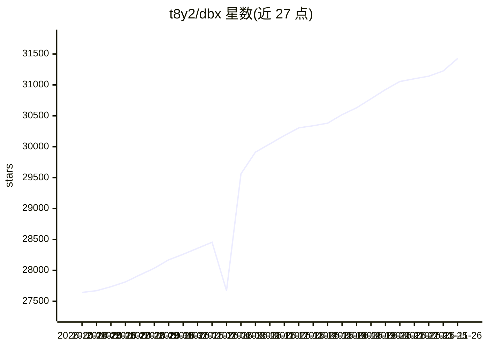

# t8y2/dbx

⭐ 31,428 · Rust · Apache-2.0 · 推送 2026-11-25 · [GitHub](https://github.com/t8y2/dbx) · [官网](https://dbxio.com) · 个人维护 · 中文 README

**轻量跨平台数据库客户端，支持100+数据库，内置AI助手**

Rust 编写的开源数据库管理工具，单二进制约 25 MB，无 JRE/Python/Chromium。支持 MySQL、PostgreSQL、SQLite、Redis、MongoDB、达梦等 100+ 数据库，提供 macOS/Windows/Linux 桌面端、Docker/Web 自托管与 CLI 三种形态。内置 AI SQL 助手：自然语言生成 SQL、解释、优化、纠错，AI 生成的 SQL 经内置安全检查后执行；另提供独立分发的 MCP Server，使 Claude Code、Cursor 等 AI agent 能通过 DBX 已配置的连接查询数据库。附带消息队列与中间件控制台、签名沙箱插件商店、SSH 隧道与连接加密导出。

## 筛选速览

| 维度 | 判定 | 备注 |
|---|---|---|
| AI 角色 | `ai-enhanced` | 去掉 AI 部分产品仍成立 |
| 许可风险 | `permissive` | Apache-2.0 |
| 部署形态 | `desktop` | 安装包/桌面程序 |
| 模型依赖 | local-ok | 支持本地模型 |
| 硬件要求 | — | 无带数字的原话,不猜 |
| 安装摩擦 | `low` | 无编译、无系统依赖或容器化 |
| 成熟度 | — | 结构信号不足 |

## 动量与使用信号

- 维护:`active` — 距上次 push 0.7 天,年发版 100,364 位贡献者
- 涨星:近 1 天 **+123**(自 20261016 起算)
- 安装:npm 包 `@dbx-app/mcp-server` 月下载 45,076
- 平台:— · 协议:OPENAI-API / MCP / OLLAMA

## 能力要点

- 单二进制约 25 MB，覆盖 100+ 数据库，无 JRE/Python/Chromium 运行时
- AI SQL 助手支持 Claude、OpenAI、本地模型及 OpenAI 兼容端点，生成 SQL 有安全检查
- 独立 MCP Server + CLI Agent Skill，供 AI coding agent 查询数据库
- 消息队列（Kafka/RocketMQ 等）与中间件（Nacos/etcd 等）控制台、签名沙箱插件商店

## 适用场景

- 用一个客户端管理多种数据库与消息队列/中间件
- 自然语言生成、解释、优化 SQL 并安全执行
- 让 Claude Code/Cursor 等 agent 通过 MCP 访问团队数据库
- Docker 自托管为团队提供 Web 端数据库访问

## 场景标签

`数据分析` · 领域:效率与自动化

## 证据(README 行号)

> L103:  🪶 25 MB, zero runtime bloat
> L107:  Highlight a table, describe what you want, get SQL back — no copy-paste between tools. Works with Claude, OpenAI,
> L110:  DBX speaks the Model Context Protocol. Claude Code, Cursor, Windsurf, and other AI coding agents can query your d
> L187: DBX provides a separate Rust-powered MCP server that lets AI coding agents query databases using connections confi

## 星数曲线

2026-10-24 27,642 → 2026-11-26 31,428（+3,786）

---
*卡片 v1 · prompt 1.4 · 生成 2026-11-22 · 置信度 high · 依据 README sha `0c5df51b735c` · [字段定义](../../DATASET.md)*
