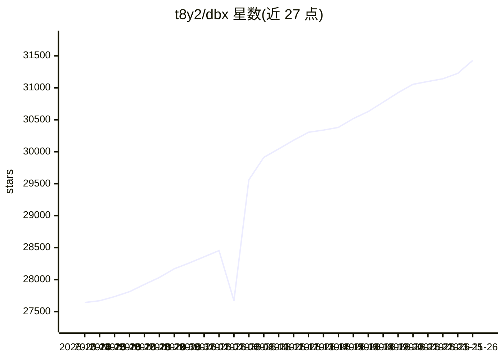

# t8y2/dbx

⭐ 31,428 · Rust · Apache-2.0 · 推送 2026-11-25 · [GitHub](https://github.com/t8y2/dbx) · [官网](https://dbxio.com) · 个人维护 · 中文 README

**内置 AI 助手与 MCP 的 25MB 跨平台数据库客户端**

以 Rust 编写的轻量级数据库管理工具，单二进制约 25 MB，无需 Java/Python/Chromium 运行时。支持 100+ 数据库连接，提供查询编辑器、数据网格、Schema 工具（ER 图、diff、执行计划）、数据导入导出与传输，并为 Kafka、RocketMQ、Redis、MongoDB 等提供专用控制台。AI 部分：自然语言生成 SQL、查询解释与纠错，并附带独立分发的 MCP Server 与 CLI，供 AI 编码代理通过 DBX 连接查询数据库。提供桌面端（macOS/Windows/Linux）、Docker 自托管与 Web 版本，另有签名沙箱插件生态。

## 筛选速览

| 维度 | 判定 | 备注 |
|---|---|---|
| AI 角色 | `ai-enhanced` | 去掉 AI 部分产品仍成立 |
| 许可风险 | `permissive` | Apache-2.0 |
| 部署形态 | `desktop` | 安装包/桌面程序 |
| 模型依赖 | local-ok | 支持本地模型 |
| 硬件要求 | — | 无带数字的原话,不猜 |
| 安装摩擦 | `low` | 无编译、无系统依赖或容器化 |
| 成熟度 | — | 结构信号不足 |

## 动量与使用信号

- 维护:`active` — 距上次 push 0.7 天,年发版 100,364 位贡献者
- 涨星:近 1 天 **+123**(自 20261016 起算)
- 安装:npm 包 `@dbx-app/mcp-server` 月下载 45,076
- 平台:— · 协议:OPENAI-API / MCP / OLLAMA

## 能力要点

- 支持 MySQL、PostgreSQL、Redis、MongoDB、达梦等 100+ 数据库
- 内置 AI SQL 助手，生成结果经安全检查后才执行
- 独立 MCP Server，AI 代理可用 DBX 配置的连接查询数据库，含三级权限模式
- 消息队列与中间件控制台（Kafka/RocketMQ/RabbitMQ/Pulsar/MQTT 等）

## 适用场景

- 用一个客户端管理公司里的多种数据库与中间件
- 让 Claude Code、Cursor 等 AI 代理通过 MCP 安全查询数据库
- 通过 Docker 自托管为团队提供 Web 访问
- 用自然语言生成、解释与优化 SQL

## 场景标签

`数据分析` · 领域:效率与自动化

## 证据(README 行号)

> L96:  🪶 25 MB, zero runtime bloat
> L99:  🤖 AI that lives in your editor
> L126: Describe what you want in plain language — get SQL back. DBX can explain queries, optimize SQL, fix errors, and ru

## 星数曲线

2026-10-24 27,642 → 2026-11-26 31,428（+3,786）

---
*卡片 v1 · prompt 1.4 · 生成 2026-11-26 · 置信度 high · 依据 README sha `fa9dd7aab6f3` · [字段定义](../../DATASET.md)*
