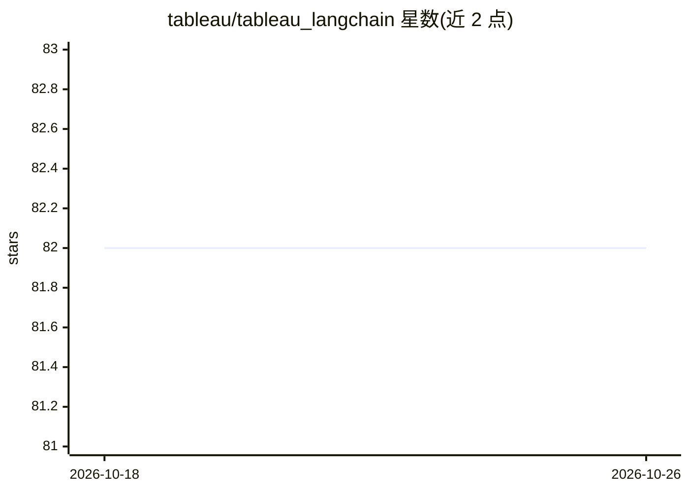

# tableau/tableau_langchain

⭐ 82 · Python · MIT · 推送 2026-02-27 · [GitHub](https://github.com/tableau/tableau_langchain) · [官网](https://pypi.org/project/langchain-tableau/) · 组织维护

**Tableau 的 LangChain/LangGraph Agentic 工具集成包**

由 Tableau 官方 OSS 组织发布的 langchain-tableau PyPI 包，将 Tableau 能力封装为 LangChain/LangGraph 框架内可用的 Tools、Utilities 与 Chains。已发布方案支持用自然语言查询已发布数据源，底层调用 Tableau VizQL Data Service 分析引擎，支持聚合与过滤，通过 API 接口防止 SQL 注入。仓库为 monorepo：experimental/ 沙箱用于开发测试，pkg/ 存放发布代码；访问 Tableau 资源需经 Connected Apps 等认证方式，凭据存于 .env。

## 筛选速览

| 维度 | 判定 | 备注 |
|---|---|---|
| AI 角色 | `ai-ecosystem` | LLM/agent 周边工具 |
| 许可风险 | `permissive` | MIT |
| 部署形态 | `library` | 以包/库形式分发 |
| 模型依赖 | — | README 未给出锁定关系 |
| 硬件要求 | — | 无带数字的原话,不猜 |
| 安装摩擦 | `low` | 无编译、无系统依赖或容器化 |
| 成熟度 | — | 结构信号不足 |

## 能力要点

- 自然语言查询 Tableau 已发布数据源（simple_datasource_qa）
- 基于 VizQL Data Service 分析引擎，支持聚合与过滤
- 以 LangChain 集成包形式发布到 PyPI（langchain-tableau）
- 含 experimental 开发沙箱、Jupyter Notebook 示例与 LangGraph Server 运行方式

## 适用场景

- 在 LangChain/LangGraph Agent 中接入 Tableau 数据做自然语言问答
- 让企业 Agent 基于现有 Tableau 分析数据源回答问题
- 参考示例 Notebook 逐步上手 Agentic 数据场景

## 场景标签

`数据分析` · 领域:效率与自动化

## 证据(README 行号)

> L7: This project builds Agentic tools from Tableau capabilities for use within the Langchain and LangGraph frameworks. S
> L145:  - Leverage the analytical engine provided by Tableau's VizQL Data Service

## 星数曲线

2026-10-18 82 → 2026-10-26 82（+0）

---
*卡片 v1 · prompt 1.4 · 生成 2026-10-24 · 置信度 high · 依据 README sha `1d90cdc2b00b` · [字段定义](../../DATASET.md)*
