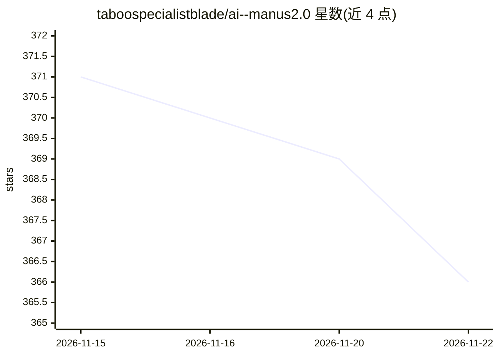

# taboospecialistblade/ai--manus2.0

⭐ 366 · Apache-2.0 · 推送 2026-11-15 · [GitHub](https://github.com/taboospecialistblade/ai--manus2.0) · 个人维护

**面向日常小任务的自主 AI Agent：代用户执行代码与浏览器操作**

README 描述的自助式 AI 代理：按自然语言指令自主编写并执行脚本、控制浏览器（导航页面、填写表单、抓取信息），可在脚本与浏览器操作间衔接完成多步骤任务，面向学习、家庭与轻量办公场景。文中给出兼容性表（双核 CPU、4 GB 内存起步）与六步上手流程，但未提供任何安装命令、源码结构、API 接入方式或技术实现细节；标题含促销码字样，页面呈推广文案风格。

## 筛选速览

| 维度 | 判定 | 备注 |
|---|---|---|
| AI 角色 | `ai-native` | 本体是模型或模型工具 |
| 许可风险 | `permissive` | Apache-2.0 |
| 部署形态 | `None` |  |
| 模型依赖 | — | README 未给出锁定关系 |
| 硬件要求 | — | 无带数字的原话,不猜 |
| 安装摩擦 | `low` | 无编译、无系统依赖或容器化 |
| 成熟度 | — | 结构信号不足 |

## 能力要点

- 自主执行代码与脚本
- 浏览器控制：导航、填表、抓取信息
- 脚本与浏览器操作衔接的多步骤任务
- 面向家庭/学习/轻量办公的小规模场景

## 适用场景

- 让代理代为整理研究资料与快速计算
- 自动浏览多网页收集信息并汇总
- 处理重复性小任务（文件检查、表单填写）

## 场景标签

`浏览器自动化` `编码 Agent` · 领域:效率与自动化

## 证据(README 行号)

> L10: - **Autonomous Code Execution:** Manus AI agent runs code on its own to complete tasks, so you can focus on decisio
> L18: Manus is an autonomous AI agent designed to run code and control a browser on your behalf. Instead of acting like a

## 星数曲线

2026-11-15 371 → 2026-11-22 366（-5）

---
*卡片 v1 · prompt 1.4 · 生成 2026-11-17 · 置信度 low · 依据 README sha `71798a5b9c2b` · [字段定义](../../DATASET.md)*
