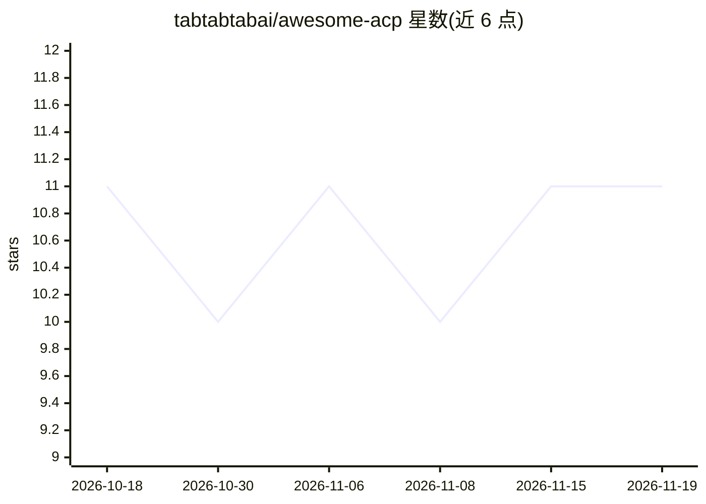

# tabtabtabai/awesome-acp

⭐ 11 · Python · CC0-1.0 · 推送 2026-06-14 · [GitHub](https://github.com/tabtabtabai/awesome-acp) · [官网](https://agentclientprotocol.com) · 组织维护

**Agent Client Protocol 生态的策展清单：连接编辑器与 AI agent**

收录 Agent Client Protocol（ACP）生态的各类资源：协议规范与 Schema、官方多语言 SDK（Rust/TypeScript/Python/Kotlin/Java）、社区语言绑定、编辑器/IDE 客户端（Zed/JetBrains/Neovim/VS Code 等）、桌面与终端客户端、移动远程控制、聊天桥接、支持 ACP 的编码 agent 清单及桥接适配器、多 agent 编排工具。面向需要在编辑器与 AI 编码 agent 之间按 ACP 标准接入、集成或选型的开发者，内容镜像官方页面与 CI 验证的 registry。

## 筛选速览

| 维度 | 判定 | 备注 |
|---|---|---|
| AI 角色 | `ai-knowledge` | 知识聚合/清单类 |
| 许可风险 | `viral` | CC0-1.0 |
| 部署形态 | `library` | 以包/库形式分发 |
| 模型依赖 | — | README 未给出锁定关系 |
| 硬件要求 | — | 无带数字的原话,不猜 |
| 安装摩擦 | `low` | 无编译、无系统依赖或容器化 |
| 成熟度 | — | 结构信号不足 |

## 能力要点

- 覆盖协议规范、官方 SDK、社区绑定、客户端、agent、适配器、编排器等 ACP 生态全貌
- 镜像官方 agent 页面与 CI 验证 registry，附每日自动生成的协议适配矩阵
- 列出 Rust/TypeScript/Python/Kotlin/Java 官方 SDK 及 Go/Swift/C#/Dart 等社区实现

## 适用场景

- 为编辑器或 IDE 选择可接入的 ACP 编码 agent
- 为自有 agent 实现 ACP 适配时查找 SDK 与参考实现
- 查找将非 ACP agent 桥接到 ACP 的适配器方案

## 场景标签

`精选清单` · 领域:学习与行业

## 证据(README 行号)

> L5: **A curated list of everything in the Agent Client Protocol (ACP) ecosystem — the open standard that connects any co
> L13: > The **Agent Client Protocol (ACP)** standardizes communication between *code editors* (and other UIs) and *AI cod

## 星数曲线

2026-10-18 11 → 2026-11-19 11（+0）

---
*卡片 v1 · prompt 1.4 · 生成 2026-11-18 · 置信度 high · 依据 README sha `f560bd25be2f` · [字段定义](../../DATASET.md)*
