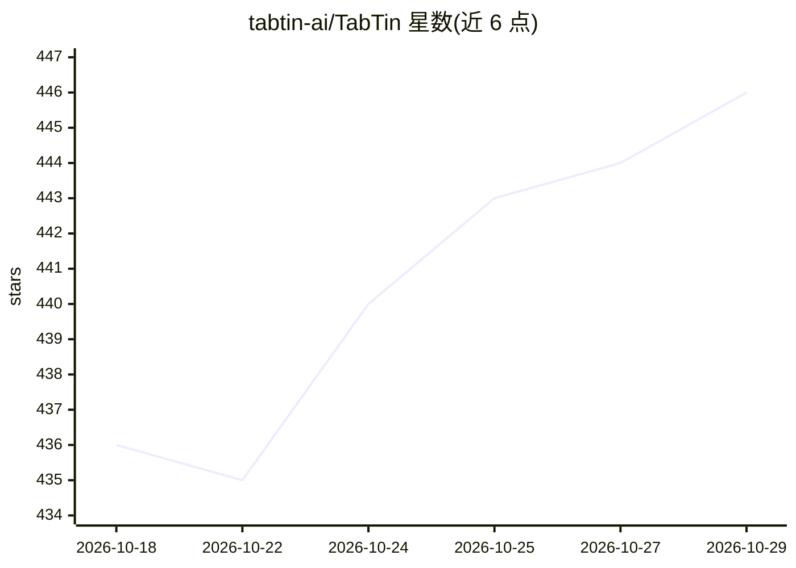

# tabtin-ai/TabTin

⭐ 446 · TypeScript · AGPL-3.0 · 推送 2026-10-07 · [GitHub](https://github.com/tabtin-ai/TabTin) · [官网](https://www.tabtin.com/) · 组织维护 · 中文 README

**人与多 Agent 团队协作平台：让 Agent 参与真实工作并支持任务交接**

开源的人与 Agent 协作平台，含桌面/移动客户端、服务端、Agent Runtime、实时协作与消息/文档/表格/演示文稿等协作应用。个人可配置 Agent、模型、Skill 与执行规则完成调研、文档、代码等工作；团队可交接任务与冻结的上下文、复用已验证方法，并通过权限、用量与执行记录追溯结果，重要判断由人完成。提供官方托管服务与本地源码运行两种入口，本地需自行准备 Node.js、Docker 等依赖；当前处于 Public Preview，部分模块为默认实现，移动端需配合桌面端在线执行环境。源码 AGPL-3.0-only，另可咨询商业授权。

## 筛选速览

| 维度 | 判定 | 备注 |
|---|---|---|
| AI 角色 | `ai-native` | 本体是模型或模型工具 |
| 许可风险 | `dual` | AGPL-3.0 |
| 部署形态 | `self-host` | docker 或自建部署 |
| 模型依赖 | — | README 未给出锁定关系 |
| 硬件要求 | — | 无带数字的原话,不猜 |
| 安装摩擦 | `low` | 无编译、无系统依赖或容器化 |
| 成熟度 | `idea` | |

## 能力要点

- 任务交接冻结对话上下文并携带引用文档，接手人可在自选 Agent/Workspace 续作
- 人与 Agent 共同操作消息、文档、多维表格、演示文稿等在线协作应用
- Agent 角色可配置规则、模型、Skill 与记忆，已验证方法可复用
- 提供官方服务与 Community Server 本机运行两种使用方式

## 适用场景

- 让 Agent 直接参与调研、文档、表格、演示文稿和代码等日常任务
- 团队间交接 AI 任务上下文与结果，避免重复调研与 Token 重复消耗
- 通过权限、用量与执行记录检查和追溯 Agent 产出
- 在本机自托管 Community Server 评估与二次开发

## 场景标签

`多智能体` · 领域:Agent 开发

## 证据(README 行号)

> L13: TabTin 是一个开源的人与 Agent 协作平台，面向希望把 Agent 带进真实工作的个人和团队。我们希望降低人和 Agent 共同工作的协作成本，让个人完成的工作能够被团队接续、复用和检查。
> L59: TabTin 不只提供客户端，也包括服务端、Agent Runtime、实时协作、工作应用和管理能力。个人和小团队可以直接使用官方服务；开发者可以在自己的电脑上运行 Community Server，也可以从源码继续修改。
> L77: 计划公开的系统包括桌面和移动客户端、服务端、Agent Runtime、实时协作、消息、文档、表格、演示文稿、模型管理和管理后台等组成部分。Public Preview 阶段的最终范围和可用状态，以发布快照及验证记录为准。

## 星数曲线

2026-10-18 436 → 2026-10-29 446（+10）

---
*卡片 v1 · prompt 1.4 · 生成 2026-10-21 · 置信度 mid · 依据 README sha `f5457bbcfe6a` · [字段定义](../../DATASET.md)*
