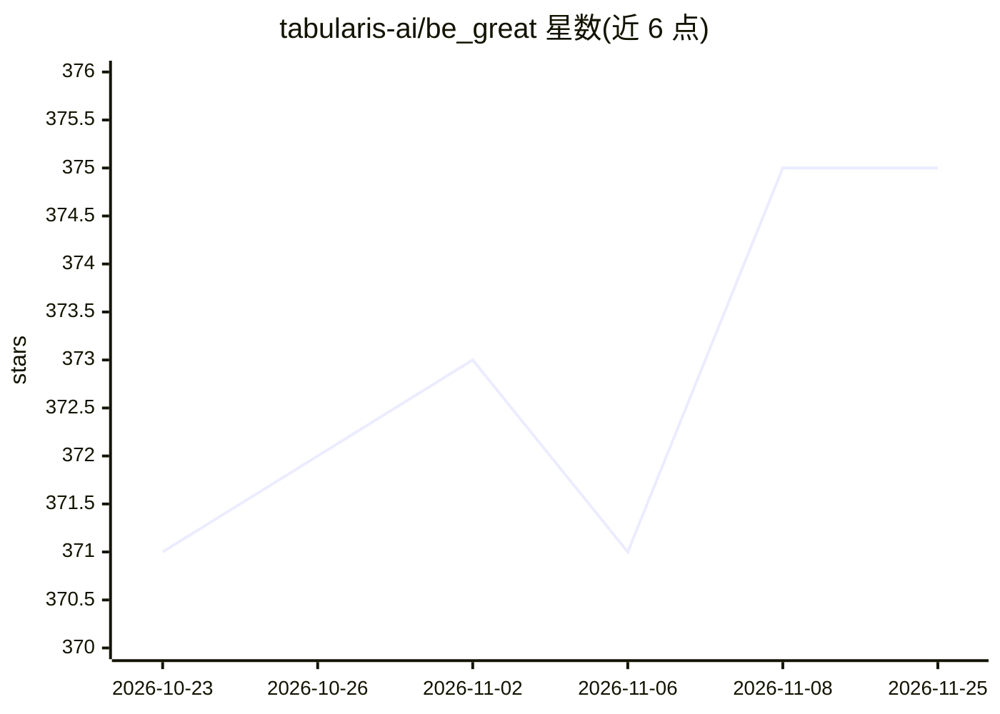

# tabularis-ai/be_great

⭐ 375 · Python · MIT · 推送 2026-11-15 · [GitHub](https://github.com/tabularis-ai/be_great) · 组织维护

**用预训练语言模型生成合成表格数据的 Python 库**

GReaT 框架基于预训练 Transformer 语言模型生成合成表格数据，以 Python 库形式通过 PyPI 分发，提供 fit/sample 风格 API。支持缺失值插补、带逻辑运算符的约束采样、无需真实数据的声明式 schema 造数、LoRA 参数高效微调、训练中的质量监控，并内置统计、保真度/效用与隐私三类评估指标。要求 Python >= 3.9，依赖 huggingface transformers Trainer，作者提供论文引用条目。

## 筛选速览

| 维度 | 判定 | 备注 |
|---|---|---|
| AI 角色 | `ai-native` | 本体是模型或模型工具 |
| 许可风险 | `permissive` | MIT |
| 部署形态 | `library` | 以包/库形式分发 |
| 模型依赖 | — | README 未给出锁定关系 |
| 硬件要求 | — | 无带数字的原话,不猜 |
| 安装摩擦 | `low` | 无编译、无系统依赖或容器化 |
| 成熟度 | — | 结构信号不足 |

## 能力要点

- 基于预训练 Transformer 语言模型生成合成表格数据
- 约束采样支持 >=, <=, ==, != 等逻辑运算符，逐 token 强制约束
- 内置评估套件：统计相似性、判别器/ML 效用、距离最近记录等隐私指标
- 支持 LoRA 微调与训练过程中的实时质量评分

## 适用场景

- 为机器学习任务生成补充的合成表格数据集
- 填充表格数据中任意组合的缺失值
- 按声明式 schema 生成隐私安全的测试与开发用假数据
- 评估合成数据的质量、效用与隐私风险

## 场景标签

 · 领域:数据合成/机器学习

## 证据(README 行号)

> L16: Our GReaT framework leverages the power of advanced pretrained Transformer language models to produce high-quality 
> L26: pip install be-great

## 星数曲线

2026-10-23 371 → 2026-11-25 375（+4）

---
*卡片 v1 · prompt 1.4 · 生成 2026-11-25 · 置信度 high · 依据 README sha `27cd15610ca6` · [字段定义](../../DATASET.md)*
