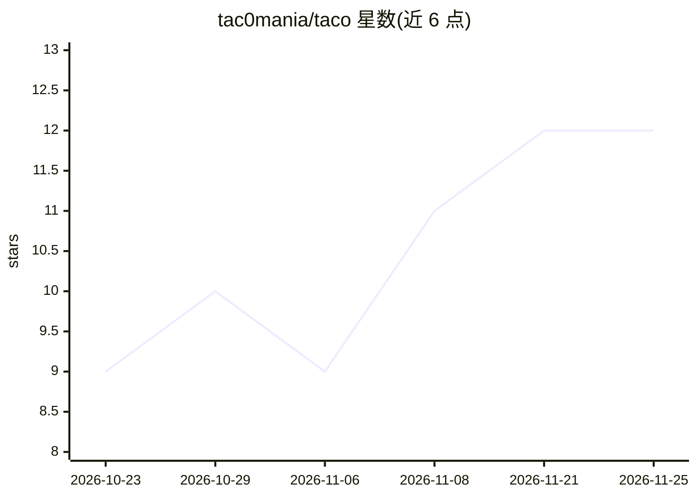

# tac0mania/taco

⭐ 12 · Rust · Apache-2.0 · 推送 2026-10-20 · [GitHub](https://github.com/tac0mania/taco) · [官网](https://github.com/tac0mania/taco/releases) · 个人维护

**用整数算术跑 GPT-2 的跨平台无损压缩器（alpha）**

Taco 是一个以 GPT-2 做预测、配合区间编码的无损压缩器（fold/unfold），其推理引擎 HardShell 只用整数运算，避免浮点在不同 CPU/GPU 上的舍入差异，使一端压缩的文件在 macOS/Linux/Windows 与 CPU/CUDA/Vulkan/Metal 后端上解压字节一致。提供预编译程序下载与从源码构建两条路径，README 明确标注 alpha 概念验证、速度慢，且双端需持有 127 MB 模型文件。

## 筛选速览

| 维度 | 判定 | 备注 |
|---|---|---|
| AI 角色 | `ai-native` | 本体是模型或模型工具 |
| 许可风险 | `permissive` | Apache-2.0 |
| 部署形态 | `desktop` | 安装包/桌面程序 |
| 模型依赖 | — | README 未给出锁定关系 |
| 硬件要求 | — | 无带数字的原话,不猜 |
| 安装摩擦 | `medium` | 含编译或系统依赖之一 |
| 成熟度 | `idea` | |

## 能力要点

- 整数算术推理使压缩结果跨机器字节一致
- 支持 CPU（NEON/AVX2）、CUDA 与 wgpu（Vulkan/Metal/DX12）后端
- 提供精确分数权重转换，任意机器生成相同的 gpt2.hsm
- 提供预编译二进制（macOS Apple Silicon/Linux x86-64/Windows x86-64）

## 适用场景

- 在 Mac 上压缩文件并在 Windows/Linux 机器上无损还原
- 验证跨硬件平台的模型推理结果一致性
- 对英文文本、服务器日志等小文件做压缩实验

## 场景标签

 · 领域:数据压缩/系统工具

## 证据(README 行号)

> L5: Taco is a lossless compressor that uses a language model (GPT-2). The model predicts the next
> L7: Taco, **HardShell**, runs the model with **integer arithmetic only**. Thus every CPU and GPU
> L9: decompresses ("unfolds") on every other machine.

## 星数曲线

2026-10-23 9 → 2026-11-25 12（+3）

---
*卡片 v1 · prompt 1.4 · 生成 2026-11-18 · 置信度 high · 依据 README sha `9d62ca11ad40` · [字段定义](../../DATASET.md)*
