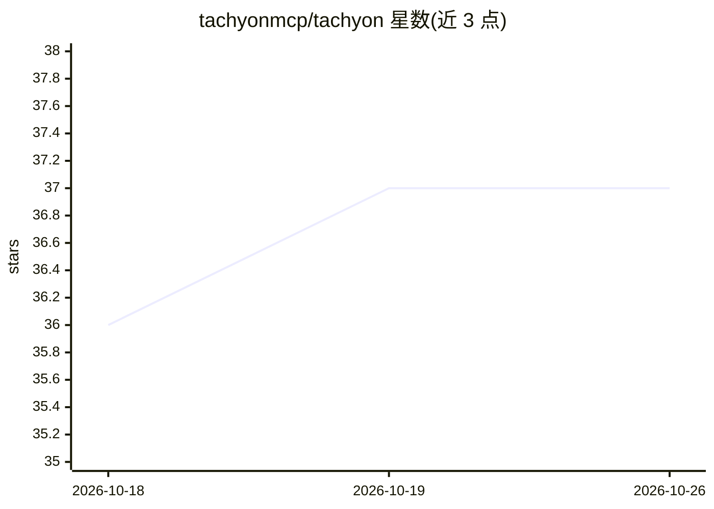

# tachyonmcp/tachyon

⭐ 37 · Java · Apache-2.0 · 推送 2026-10-24 · [GitHub](https://github.com/tachyonmcp/tachyon) · [官网](https://tachyonmcp.dev) · 组织维护

**Java/Kotlin 的 MCP 服务器运行时，简化模型上下文协议服务开发**

面向 Java 21+ 开发者的 Model Context Protocol 服务器运行时，实现 MCP 2025-11-25 与 2026-07-28 规范（Streamable HTTP），通过官方一致性测试套件。支持同步 Java handler 与协程 Kotlin DSL，阻塞 handler 运行于虚拟线程，不依赖应用框架；提供 Netty 传输、可恢复会话、tasks/skills/MCP Apps 等 SEP 扩展及 OpenTelemetry 可观测性，另带 mcp-java/LangChain4j/Spring AI 注解适配器。Apache 2.0 许可。

## 筛选速览

| 维度 | 判定 | 备注 |
|---|---|---|
| AI 角色 | `ai-ecosystem` | LLM/agent 周边工具 |
| 许可风险 | `permissive` | Apache-2.0 |
| 部署形态 | `library` | 以包/库形式分发 |
| 模型依赖 | — | README 未给出锁定关系 |
| 硬件要求 | — | 无带数字的原话,不猜 |
| 安装摩擦 | `medium` | 含编译或系统依赖之一 |
| 成熟度 | — | 结构信号不足 |

## 能力要点

- 实现 MCP 2025-11-25 与 2026-07-28，通过官方一致性套件
- 阻塞 handler 运行在虚拟线程，无需应用框架或手动线程池
- Tools/Tasks/Resources/Prompts/Skills/MCP Apps 全 MCP 能力面
- 可选适配 mcp-java、LangChain4j、Spring AI 注解服务

## 适用场景

- 用 Java 或 Kotlin 快速构建 MCP 服务器暴露工具与资源
- 把已有的 LangChain4j/Spring AI 注解服务迁移为 MCP 服务器
- 需要会话重放（Last-Event-ID）与 OpenTelemetry 观测的 MCP 生产部署

## 场景标签

 · 领域:AI Agent 基础设施/MCP

## 证据(README 行号)

> L18: **Tachyon MCP** is a Java 21+ server runtime for the
> L22: Build servers with synchronous Java handlers or a coroutine-first Kotlin DSL. Tachyon runs

## 星数曲线

2026-10-18 36 → 2026-10-26 37（+1）

---
*卡片 v1 · prompt 1.4 · 生成 2026-10-25 · 置信度 mid · 依据 README sha `088769423db8` · [字段定义](../../DATASET.md)*
