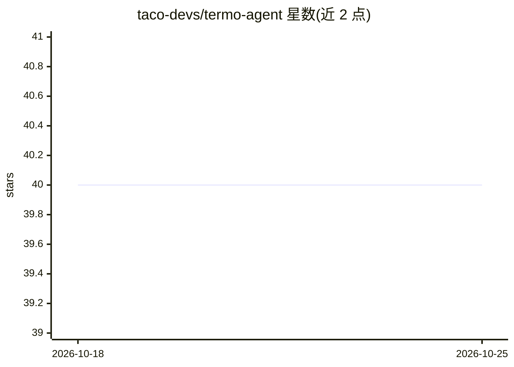

# taco-devs/termo-agent

⭐ 40 · Python · MIT · 推送 2026-03-06 · [GitHub](https://github.com/taco-devs/termo-agent) · [官网](https://termo.ai) · 组织维护

**面向 Firecracker microVM 的 AI agent 无服务器运行时**

开源的 Python 无服务器运行时，将任意 agent 框架（OpenAI Agents SDK、Claude SDK、LangChain、CrewAI 或自定义适配器）转化为生产 HTTP 服务器，提供 SSE 流式输出、会话管理、Bearer 认证、持久状态与自动休眠/唤醒生命周期。每个 agent 运行在独立 Firecracker microVM 中实现硬件级隔离，附带工具生态：shell 与文件操作、ChromaDB 语义记忆、技能市场、agent 间调用、cron 调度与 Telegram 集成。可通过 pip 安装，部署到 Termo、Fly.io 等平台。

## 筛选速览

| 维度 | 判定 | 备注 |
|---|---|---|
| AI 角色 | `ai-ecosystem` | LLM/agent 周边工具 |
| 许可风险 | `permissive` | MIT |
| 部署形态 | `self-host` | docker 或自建部署 |
| 模型依赖 | locked-api |  |
| 硬件要求 | — | 无带数字的原话,不猜 |
| 安装摩擦 | `low` | 无编译、无系统依赖或容器化 |
| 成熟度 | — | 结构信号不足 |

## 能力要点

- Firecracker microVM 隔离，VM 约 125ms 启动、<5MB 内存开销
- 适配器模式接入 OpenAI Agents SDK、Claude SDK、LangChain、CrewAI 等框架
- SSE 流式输出、会话管理、认证中间件与持久状态
- 内置工具生态：shell/文件操作、ChromaDB 语义记忆、技能市场、agent 间调用、cron 调度

## 适用场景

- 把现有 agent 框架封装为生产可用的 HTTP 服务
- 在隔离 VM 中让 agent 安全执行 shell 命令与安装包
- 构建具备长期记忆、定时任务与多 agent 协作的自主系统

## 场景标签

 · 领域:LLM 基础设施/Agent 运行时

## 证据(README 行号)

> L22: **termo-agent** is an open-source serverless runtime that gives every AI agent its own isolated machine. Built for 
> L40: - **Adapter Pattern** — Plug in OpenAI Agents SDK, Claude SDK, LangChain, CrewAI, or your own framework

## 星数曲线

2026-10-18 40 → 2026-10-25 40（+0）

---
*卡片 v1 · prompt 1.4 · 生成 2026-10-25 · 置信度 mid · 依据 README sha `a3d94ecc4555` · [字段定义](../../DATASET.md)*
