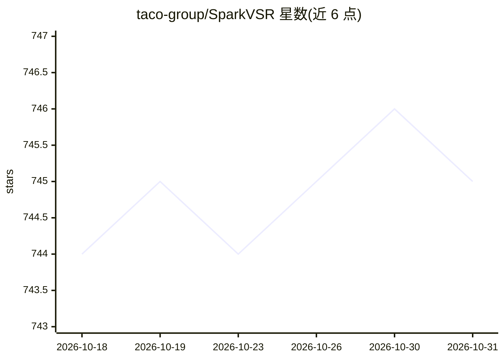

# taco-group/SparkVSR

⭐ 745 · Python · Apache-2.0 · 推送 2026-08-03 · [GitHub](https://github.com/taco-group/SparkVSR) · [官网](https://sparkvsr.github.io) · 组织维护

**基于稀疏关键帧传播的交互式视频超分辨率框架**

ECCV 2026 论文的官方实现：交互式视频超分辨率框架，用户先用任意图像超分模型（或 fal-ai nano-banana-pro API、开源 PiSA-SR）增强少量关键帧，模型将关键帧先验传播到整个视频序列，同时以原始低分辨率视频运动为约束。基于 CogVideoX1.5-5B-I2V，提供两阶段（潜空间/像素空间）训练与推理代码、预训练权重和评测脚本，还支持老电影修复、视频风格迁移等任务。训练需 4×A100 GPU。

## 筛选速览

| 维度 | 判定 | 备注 |
|---|---|---|
| AI 角色 | `ai-native` | 本体是模型或模型工具 |
| 许可风险 | `permissive` | Apache-2.0 |
| 部署形态 | `None` |  |
| 模型依赖 | — | README 未给出锁定关系 |
| 硬件要求 | — | 无带数字的原话,不猜 |
| 安装摩擦 | `medium` | 含编译或系统依赖之一 |
| 成熟度 | — | 结构信号不足 |

## 能力要点

- 关键帧先验传播到全视频序列，以低分辨率运动为约束
- 三种推理模式：API 参考（fal-ai nano-banana-pro）、PiSA-SR 开源参考、无参考盲超分
- 基于 CogVideoX1.5-5B-I2V，提供两阶段训练/推理代码与预训练权重
- 可迁移到老电影修复、视频风格迁移等未见任务

## 适用场景

- 用少量手工增强的关键帧引导整段视频超分并控制质量
- 老电影修复或低清视频素材的细节恢复
- 复现论文在 UDM10/SPMCS/RealVSR 等基准上的评测结果

## 场景标签

`图像视频处理` `微调` · 领域:感知与多模态

## 证据(README 行号)

> L37: In this paper, we propose a novel interactive VSR framework dubbed SparkVSR that makes sparse keyframes a simple an
> L141: Our model is built upon the **CogVideoX1.5-5B-I2V** base model. We provide pretrained weights for SparkVSR at diff

## 星数曲线

2026-10-18 744 → 2026-10-31 745（+1）

---
*卡片 v1 · prompt 1.4 · 生成 2026-10-21 · 置信度 high · 依据 README sha `4b624d444790` · [字段定义](../../DATASET.md)*
