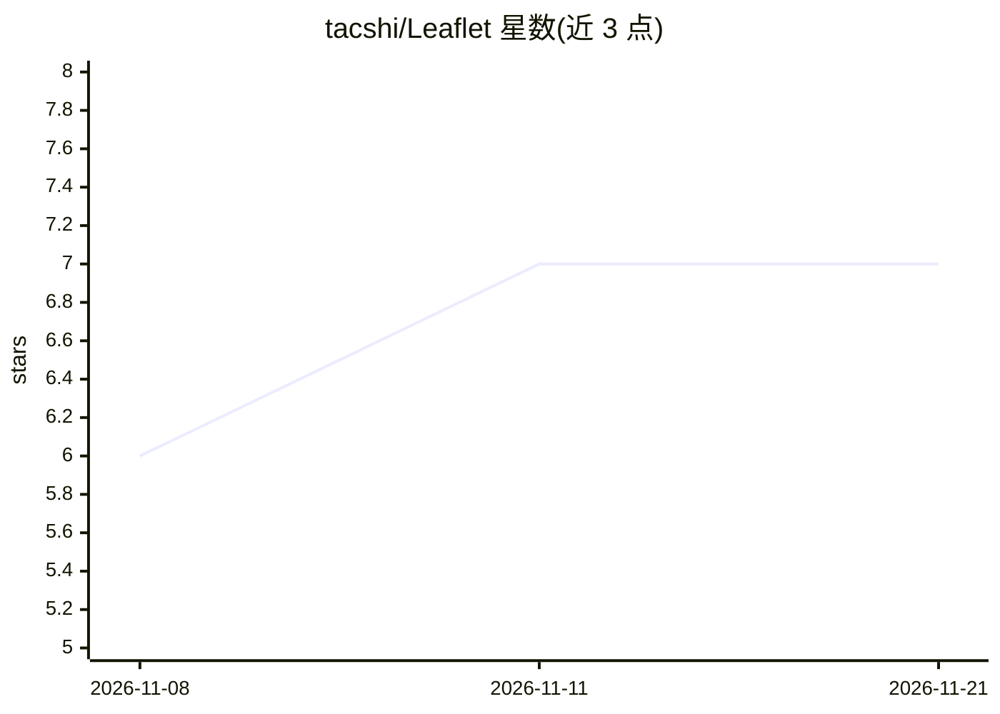

# tacshi/Leaflet

⭐ 7 · Go · MIT · 推送 2026-11-20 · [GitHub](https://github.com/tacshi/Leaflet) · [官网](https://leaflet.capyvibe.app) · 个人维护

**人们与 AI agent 共同编辑文档的原生多端笔记应用**

以块为单位的笔记应用，覆盖 macOS、Windows、iPhone 和 iPad，将笔记、规格说明与会议记录存为块页面。AI 方面：内置 inline/选区/侧栏/评论四种方式调用 agent，编辑以经过校验的工具调用流式写入页面并作为一步撤销；支持 OpenAI 兼容端点、云与本地模型，外部 agent 通过 `leaflet mcp` 服务器读写页面。数据先存本机 SQLite，经 iCloud Drive 或 Supabase 同步，离线可用。以 MIT 许可开源，App Store 同时分发 iOS 版。

## 筛选速览

| 维度 | 判定 | 备注 |
|---|---|---|
| AI 角色 | `ai-enhanced` | 去掉 AI 部分产品仍成立 |
| 许可风险 | `permissive` | MIT |
| 部署形态 | `desktop` | 安装包/桌面程序 |
| 模型依赖 | local-ok | 支持本地模型 |
| 硬件要求 | — | 无带数字的原话,不猜 |
| 安装摩擦 | `low` | 无编译、无系统依赖或容器化 |
| 成熟度 | — | 结构信号不足 |

## 能力要点

- agent 编辑以 validated tool call 形式流式写入，作为单步撤销
- 支持 OpenAI 兼容端点及 Ollama/LM Studio/llama.cpp/vLLM 本地服务器，可离线运行 agent
- `leaflet mcp` stdio 服务器与 `leaflet` CLI 供外部 agent 和脚本读写页面
- 离线优先：本地 SQLite 存储，iCloud Drive 或 Supabase 同步，块级合并

## 适用场景

- 在笔记页面中让 AI agent 读取并编辑文档，且可整体撤销
- 用 Claude Code/Codex 等外部 agent 通过 MCP 管理我的页面
- 无网络或无 API key 环境下用本地模型运行 agent
- 会议录音转写为带时间戳的笔记并与音频联动播放

## 场景标签

`知识库管理` `语音识别` · 领域:知识与检索

## 证据(README 行号)

> L5:  A native app for Mac, Windows, iPhone and iPad where people and AI agents write living documents together.
> L23: Leaflet keeps your notes, specs and meeting records as pages of blocks, and
> L97: - Any OpenAI-compatible provider: presets for OpenAI, Claude, xAI,

## 星数曲线

2026-11-08 6 → 2026-11-21 7（+1）

---
*卡片 v1 · prompt 1.4 · 生成 2026-11-20 · 置信度 high · 依据 README sha `adad09d6b8da` · [字段定义](../../DATASET.md)*
