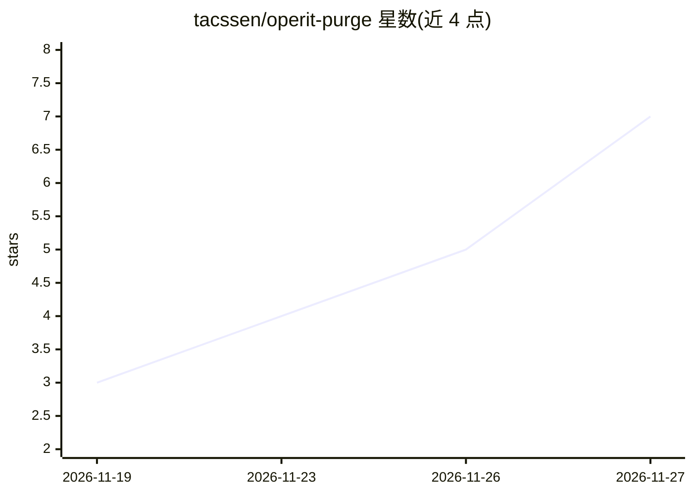

# tacssen/operit-purge

⭐ 7 · JavaScript · MIT · 推送 2026-11-07 · [GitHub](https://github.com/tacssen/operit-purge) · 个人维护 · 中文 README

**给 Operit 注入破甲提示词与拒答自动重答的 ToolPkg 插件**

以 Operit ToolPkg 形式发布的插件包，通过 SystemPromptComposeHook、ChatMessageHook 等钩子把 dsh-purge 的机制移植到 Operit：在 system prompt 末尾追加预设提示词（不替换宿主与角色卡）、对拒答做启发式检测（开头骨架+无工件、软化话术密度两级判据）并按 retryMax 限次自动补发"继续"。提供 Compose DSL 控制台管理开关、预设与日志，含 11 个子工具；只作用于 CHAT 链路，无法干预模型侧硬拒。

## 筛选速览

| 维度 | 判定 | 备注 |
|---|---|---|
| AI 角色 | `ai-ecosystem` | LLM/agent 周边工具 |
| 许可风险 | `permissive` | MIT |
| 部署形态 | `None` |  |
| 模型依赖 | — | README 未给出锁定关系 |
| 硬件要求 | — | 无带数字的原话,不猜 |
| 安装摩擦 | `low` | 无编译、无系统依赖或容器化 |
| 成熟度 | — | 结构信号不足 |

## 能力要点

- SystemPromptComposeHook 追加式注入，保留宿主提示与角色卡
- 两级拒答检测（骨架+无工件 / 软化话术密度）与限次自动重答
- Compose DSL 控制台：开关、预设、自检、日志管理
- guardUntil 120 秒防循环机制避免无限重答

## 适用场景

- 在 Operit 中给指定会话启用预设提示词注入
- 自动检测并重试命中拒答的回复
- 通过控制台日志核对误判并调整检测标记

## 场景标签

`提示工程` · 领域:Agent 开发

## 证据(README 行号)

> L3: 把 dsh-purge 那套"不拒答、不软化、先给工件"的机制搬进 Operit。
> L5: 产出一个可直接导入的 ToolPkg：`release/operit_purge.toolpkg`。
> L11: |破甲提示词注入|`SystemPromptComposeHook`（`after_compose_system_prompt`）|追加到宿主既有 system prompt 末尾，**不替换**角色卡和宿主提示|

## 星数曲线

2026-11-19 3 → 2026-11-27 7（+4）

---
*卡片 v1 · prompt 1.4 · 生成 2026-11-21 · 置信度 high · 依据 README sha `943965191e27` · [字段定义](../../DATASET.md)*
