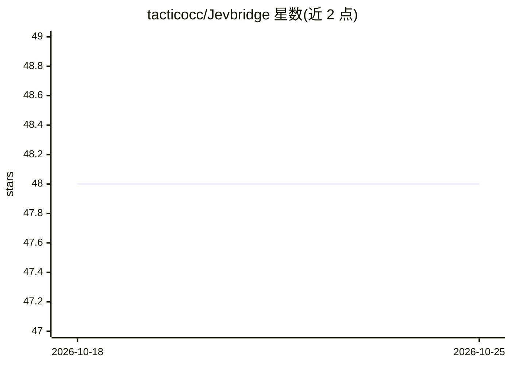

# tacticocc/Jevbridge

⭐ 48 · TypeScript · MIT · 推送 2026-09-21 · [GitHub](https://github.com/tacticocc/Jevbridge) · 个人维护

**把 TypeSafe Jev 接入 LLM 的 MCP/ACP 决策适配器**

Node 22 零依赖库，附带 MCP 与 ACP stdio 二进制。它把 TypeSafe Jev（非结构化状态输入、类型化概率决策输出的 System One 模型）作为 LLM 旁路的决策侧车：配置 TYPESAFE_API_KEY 用原生 Jev，否则将 Codex/Claude/Grok/OpenCode 或任意 OpenAI 兼容端点当作 System One，无 key 时回退到本地启发式打分。提供置信度门控（execute/confirm/escalate/abort）、封闭动作集的 computer-use 选择、ACP 代理拦截上游 agent 工具调用。限制：README 明言启发式分数仅作冒烟测试而非安全信号；npm 包尚未发布。

## 筛选速览

| 维度 | 判定 | 备注 |
|---|---|---|
| AI 角色 | `ai-ecosystem` | LLM/agent 周边工具 |
| 许可风险 | `permissive` | MIT |
| 部署形态 | `library` | 以包/库形式分发 |
| 模型依赖 | — | README 未给出锁定关系 |
| 硬件要求 | — | 无带数字的原话,不猜 |
| 安装摩擦 | `low` | 无编译、无系统依赖或容器化 |
| 成熟度 | `idea` | |

## 能力要点

- MCP 工具 jev_decide/jev_gate/jev_computer_use 与 ACP over stdio 双协议
- 后端可切换（jev|llm|heuristic|auto），无 API key 可离线运行
- 置信度门控工具调用与破坏性操作确认
- ACP 代理模式拦截 Claude Code / Codex 上游的工具调用权限

## 适用场景

- 在 Claude Desktop/Cursor/Zed 中给生成模型加类型化决策工具
- 对破坏性命令或 GUI 点击做置信度门控
- computer-use 循环中从封闭动作集选下一步操作

## 场景标签

`GUI 自动化` · 领域:效率与自动化

## 证据(README 行号)

> L53: TypeSafe Jev is a System One model: unstructured state in, typed probabilistic decisions out. It does not generate 
> L59: - **ACP over stdio** so Zed, JetBrains, and other Agent Client Protocol hosts can treat Jev as the decision sidecar
> L181: Jevbridge speaks the Model Context Protocol over stdio (newline-delimited JSON-RPC 2.0). Point Claude Desktop, Cur

## 星数曲线

2026-10-18 48 → 2026-10-25 48（+0）

---
*卡片 v1 · prompt 1.4 · 生成 2026-10-25 · 置信度 mid · 依据 README sha `4be205f9bf2e` · [字段定义](../../DATASET.md)*
