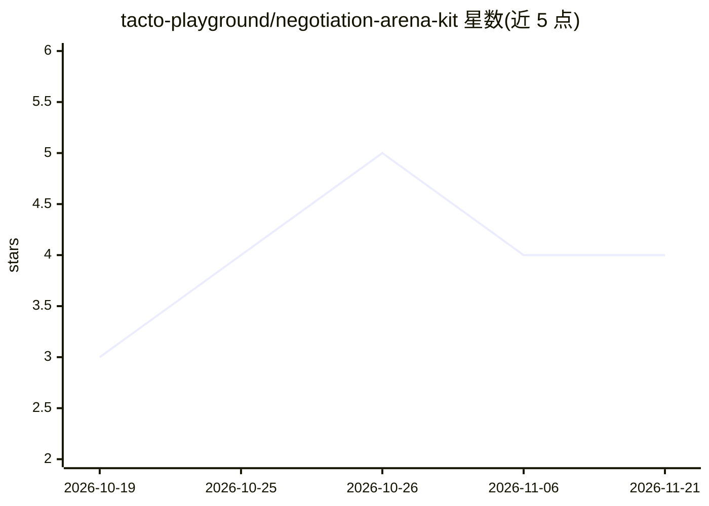

# tacto-playground/negotiation-arena-kit

⭐ 4 · Python · MIT · 推送 2026-11-16 · [GitHub](https://github.com/tacto-playground/negotiation-arena-kit) · [官网](https://arena.tacto.ai) · 组织维护

**为黑客松参赛者提供的 AI 采购谈判 agent 挑战工具包**

Tacto 在 Industrial Agents Hackathon 2026 举办谈判挑战赛的配套仓库：参赛者扮演虚构泵厂的采购团队，构建读取公司数据、通过邮件与主办方托管的供应商 bot 谈判并达成最优交易的 AI buyer agent。仓库包含 brief、API 文档、Python starter kit（客户端、naive 与 LLM 示例 agent、Live Final runner、本地模拟器 arena-sim、MCP server）及 CSV/SQLite/facts.json 数据包。参赛者自带任意 provider 的 LLM，供应商端由主办方运行，赛制要求 Live Final 期间无人工介入。

## 筛选速览

| 维度 | 判定 | 备注 |
|---|---|---|
| AI 角色 | `ai-ecosystem` | LLM/agent 周边工具 |
| 许可风险 | `permissive` | MIT |
| 部署形态 | `None` |  |
| 模型依赖 | — | README 未给出锁定关系 |
| 硬件要求 | — | 无带数字的原话,不猜 |
| 安装摩擦 | `low` | 无编译、无系统依赖或容器化 |
| 成熟度 | — | 结构信号不足 |

## 能力要点

- Python starter kit 含客户端、两种示例 agent、Live Final runner 与本地模拟器 arena-sim
- 数据包提供 CSV、SQLite、facts.json、合同与信件，并可通过 uv run arena data 更新
- 提供基于数据的 MCP server
- 赛程含练习赛（每队每 24 小时 600 场）与周日 Live Final 隐藏案例排名

## 适用场景

- 周末黑客松中构建并迭代邮件谈判 agent
- 用本地模拟器离线练习谈判策略
- 为 LLM agent 提供采购谈判领域的练习数据与接口

## 场景标签

`Agent 框架` · 领域:Agent 开发

## 证据(README 行号)

> L12: **AI buyer agent** that reads the company's data, negotiates by e-mail with our supplier bots, and
> L48: |Starter kit: client, example agents, Live Final runner, local simulator, MCP server|starter-kit/|

## 星数曲线

2026-10-19 3 → 2026-11-21 4（+1）

---
*卡片 v1 · prompt 1.4 · 生成 2026-11-21 · 置信度 mid · 依据 README sha `7f18f3918f87` · [字段定义](../../DATASET.md)*
