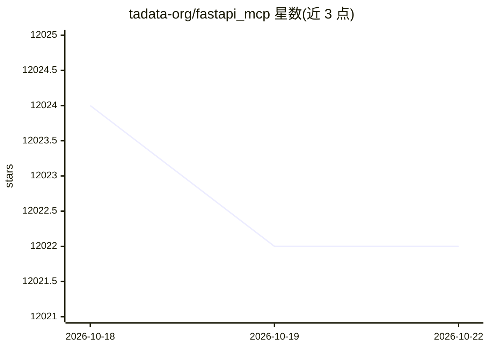

# tadata-org/fastapi_mcp

⭐ 12,022 · Python · MIT · 推送 2025-11-24 · [GitHub](https://github.com/tadata-org/fastapi_mcp) · [官网](https://fastapi-mcp.tadata.com/) · 组织维护

**将 FastAPI 端点暴露为 MCP 工具的 Python 库**

由 Tadata 维护的开源库，把现有 FastAPI 应用的端点自动转换为 Model Context Protocol (MCP) 工具，供 Claude、Cursor 等 MCP 客户端调用。复用 FastAPI 原生 Depends() 依赖做认证授权，保留请求/响应模型 schema 与端点文档，通过 ASGI 接口直接通信，支持挂载到同一应用或独立部署。需 Python 3.10+，另有 tadata.com 托管方案，MIT 许可。

## 筛选速览

| 维度 | 判定 | 备注 |
|---|---|---|
| AI 角色 | `ai-ecosystem` | LLM/agent 周边工具 |
| 许可风险 | `permissive` | MIT |
| 部署形态 | `library` | 以包/库形式分发 |
| 模型依赖 | — | README 未给出锁定关系 |
| 硬件要求 | — | 无带数字的原话,不猜 |
| 安装摩擦 | `low` | 无编译、无系统依赖或容器化 |
| 成熟度 | — | 结构信号不足 |

## 能力要点

- 复用 FastAPI Depends() 依赖实现 MCP 端点认证授权
- 通过 ASGI 接口直连 FastAPI 应用，无需 MCP 到 API 的 HTTP 调用
- 保留请求/响应模型 schema 与端点文档
- 支持挂载到同一应用或独立部署

## 适用场景

- 为已有 FastAPI 服务快速生成 MCP 工具供 Claude/Cursor 使用
- 在 MCP 端点上沿用现有的认证授权逻辑
- 统一部署 FastAPI 应用与 MCP 服务器

## 场景标签

 · 领域:LLM 基础设施/MCP

## 证据(README 行号)

> L9:  Expose your FastAPI endpoints as Model Context Protocol (MCP) tools, with Auth!
> L23: - **FastAPI-native:** Not just another OpenAPI -> MCP converter

## 星数曲线

2026-10-18 12,024 → 2026-10-22 12,022（-2）

---
*卡片 v1 · prompt 1.4 · 生成 2026-10-20 · 置信度 high · 依据 README sha `0a5ebb17c157` · [字段定义](../../DATASET.md)*
