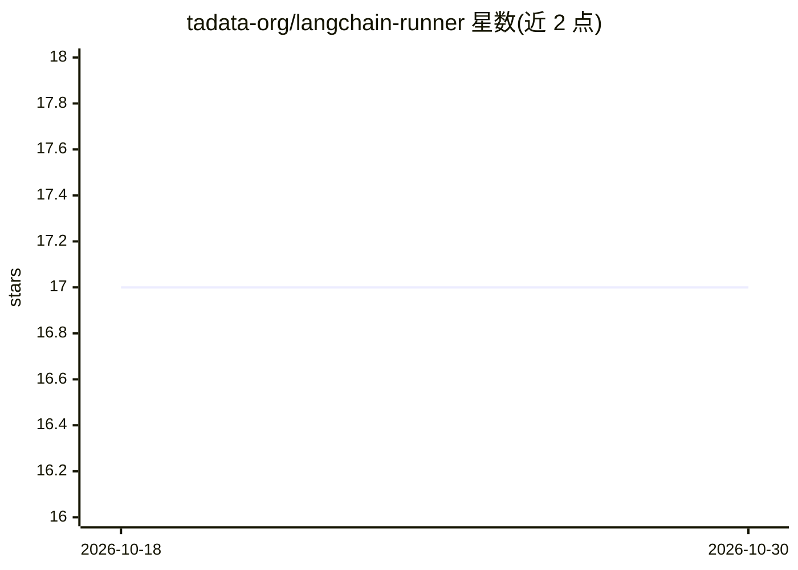

# tadata-org/langchain-runner

⭐ 17 · Python · MIT · 推送 2025-12-17 · [GitHub](https://github.com/tadata-org/langchain-runner) · [官网](https://tadata.com) · 组织维护

**将 LangChain/LangGraph agent 封装为带触发器的 Web 服务**

面向 LangChain/LangGraph 开发者的 Python 库：用 Runner 类包装 agent，无需编写基础设施代码即可获得 webhook、cron 定时与 HTTP 触发端点，agent 在后台执行并即时返回 run_id，通过 /runs 端点追踪状态与结果。支持任意符合 LangGraph 消息格式的可调用对象，可通过 MCP 适配器接入外部工具，提供 CLI 与环境变量配置。要求 Python 3.10+，MIT 许可。

## 筛选速览

| 维度 | 判定 | 备注 |
|---|---|---|
| AI 角色 | `ai-ecosystem` | LLM/agent 周边工具 |
| 许可风险 | `permissive` | MIT |
| 部署形态 | `library` | 以包/库形式分发 |
| 模型依赖 | — | README 未给出锁定关系 |
| 硬件要求 | — | 无带数字的原话,不猜 |
| 安装摩擦 | `low` | 无编译、无系统依赖或容器化 |
| 成熟度 | — | 结构信号不足 |

## 能力要点

- webhook/cron/HTTP 三类触发器自动生成端点
- 后台执行 + run_id 追踪运行状态与结果
- 支持任意 LangGraph 消息格式可调用对象
- MCP 适配器（pip install langchain-runner[mcp]）接入外部工具

## 适用场景

- 把已有 LangChain agent 快速暴露为可被外部系统调用的服务
- 用 cron 表达式定时触发 agent 执行例行业务
- 接收 GitHub/Stripe/Clerk 等 webhook 并交给 agent 处理

## 场景标签

`工作流自动化` · 领域:效率与自动化

## 证据(README 行号)

> L3: **Zero-configuration way to expose your LangChain/LangGraph agents as autonomous services.**
> L5: Simply wrap your agent with `Runner` and it becomes a web service with webhook endpoints, cron schedules, and HTTP t
> L20: from langchain_runner import Runner

## 星数曲线

2026-10-18 17 → 2026-10-30 17（+0）

---
*卡片 v1 · prompt 1.4 · 生成 2026-10-29 · 置信度 high · 依据 README sha `5ad1e6b15eb7` · [字段定义](../../DATASET.md)*
