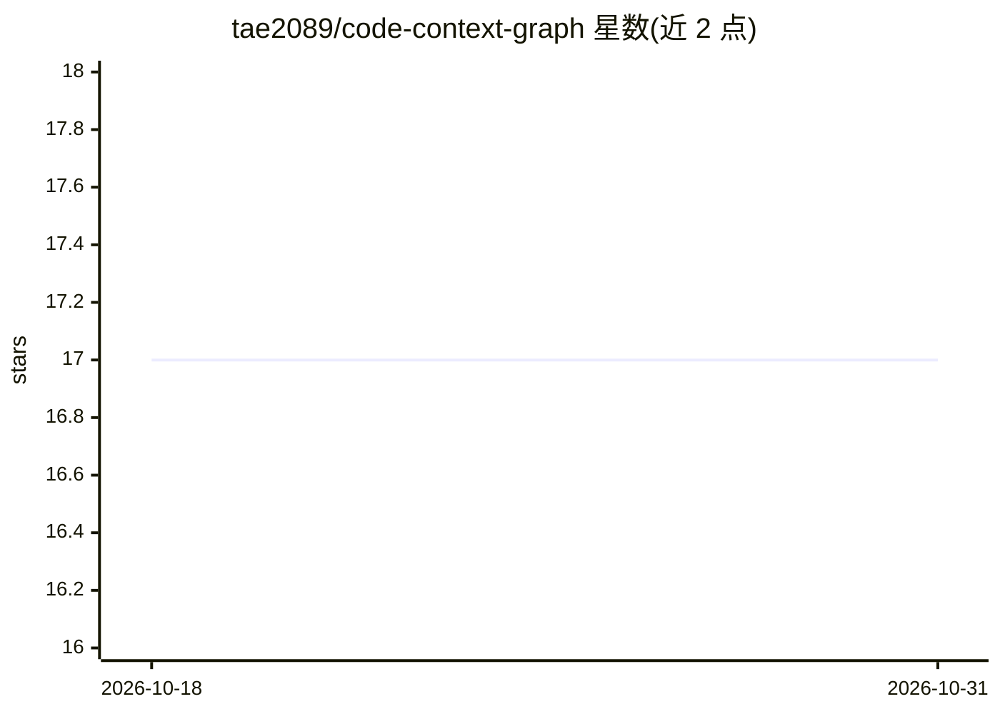

# tae2089/code-context-graph

⭐ 17 · Go · MIT · 推送 2026-08-21 · [GitHub](https://github.com/tae2089/code-context-graph) · 个人维护 · 中文 README

**面向 AI 编码代理的无向量代码检索与知识图谱工具**

用 Tree-sitter 将代码库解析为知识图谱，支持 12 种语言，提供 18 个 MCP 工具供 GPT、Claude、Codex 等 LLM 编码代理调用：按标识符与业务意图（@intent、@domainRule 等自定义注解）搜索代码、查询调用图、追踪影响与流程、生成文档。存储支持 SQLite 与 PostgreSQL（FTS5 / tsvector 全文检索），附带浏览器 Wiki UI 与 GitHub/Gitea webhook 自动同步。开发者操作的工具，非通用 SaaS 产品。

## 筛选速览

| 维度 | 判定 | 备注 |
|---|---|---|
| AI 角色 | `ai-ecosystem` | LLM/agent 周边工具 |
| 许可风险 | `permissive` | MIT |
| 部署形态 | `self-host` | docker 或自建部署 |
| 模型依赖 | — | README 未给出锁定关系 |
| 硬件要求 | — | 无带数字的原话,不猜 |
| 安装摩擦 | `low` | 无编译、无系统依赖或容器化 |
| 成熟度 | — | 结构信号不足 |

## 能力要点

- Tree-sitter 解析为知识图谱，支持 12 种语言、18 个 MCP 工具
- 按业务意图注解（@intent/@domainRule/@sideEffect 等）搜索代码
- SQLite 与 PostgreSQL 双后端，含后端一致性测试
- ccg-server 提供 Wiki UI 与 webhook 自动 clone + 构建

## 适用场景

- 让编码代理按业务意图检索代码而无需读取整个仓库
- 检查调用图、追踪影响范围与执行流程
- 通过 GitHub/Gitea push 事件自动重建代码图谱

## 场景标签

`知识图谱` · 领域:知识与检索

## 证据(README 行号)

> L5: CCG is built primarily for GPT, Claude, Codex, and other LLM-based coding agents. It acts as local or self-hosted co
> L166: ## MCP Server

## 星数曲线

2026-10-18 17 → 2026-10-31 17（+0）

---
*卡片 v1 · prompt 1.4 · 生成 2026-10-29 · 置信度 mid · 依据 README sha `e0fa25a6ccf0` · [字段定义](../../DATASET.md)*
