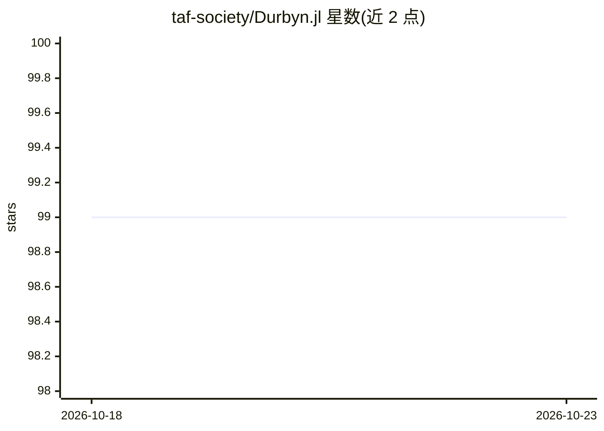

# taf-society/Durbyn.jl

⭐ 99 · Julia · Apache-2.0 · 推送 2026-09-04 · [GitHub](https://github.com/taf-society/Durbyn.jl) · [官网](https://taf-society.github.io/Durbyn.jl/dev) · 组织维护

**Julia 时间序列预测包：公式接口声明式拟合多类预测模型**

TAFS（维也纳注册非营利协会）维护的开源 Julia 包，提供指数平滑、ARIMA、ARARMA、Theta、BATS/TBATS 及 Croston 间歇需求等多类预测引擎。核心机制为 @formula 声明式公式接口，支持单序列、外生回归变量、多模型同时拟合与面板数据的分组拟合；另提供数组接口直接调用引擎。面板数据拟合支持多线程并行加速。遵循 Hyndman & Athanasopoulos 结构化预测工作流，附 TableOps 数据整理工具。Apache 2.0 许可。

## 筛选速览

| 维度 | 判定 | 备注 |
|---|---|---|
| AI 角色 | `ai-native` | 本体是模型或模型工具 |
| 许可风险 | `permissive` | Apache-2.0 |
| 部署形态 | `None` |  |
| 模型依赖 | — | README 未给出锁定关系 |
| 硬件要求 | — | 无带数字的原话,不猜 |
| 安装摩擦 | `low` | 无编译、无系统依赖或容器化 |
| 成熟度 | — | 结构信号不足 |

## 能力要点

- @formula 声明式公式接口，支持面板数据与多模型比较
- 引擎覆盖 ETS/ARIMA/ARARMA/Theta/BATS/TBATS/Croston 间歇需求
- TBATS 用傅里叶表示处理非整数季节周期（O(k) 复杂度）
- 面板数据拟合自动多线程并行，性能随核数扩展

## 适用场景

- 对单序列或面板数据做时间序列预测
- 备件、慢销品等大量零值间歇需求的预测
- 多模型批量拟合并比较预测精度

## 场景标签

 · 领域:时间序列预测/统计计算

## 证据(README 行号)

> L7: **Durbyn** is a Julia package for time-series forecasting. It provides a native Julia implementation with its own fo
> L50: Durbyn ships with multiple forecasting engines and a unified **formula interface**
> L72: - `Durbyn.ExponentialSmoothing`, `Durbyn.Arima`, `Durbyn.Ararma`,

## 星数曲线

2026-10-18 99 → 2026-10-23 99（+0）

---
*卡片 v1 · prompt 1.4 · 生成 2026-10-23 · 置信度 high · 依据 README sha `62aa55683968` · [字段定义](../../DATASET.md)*
