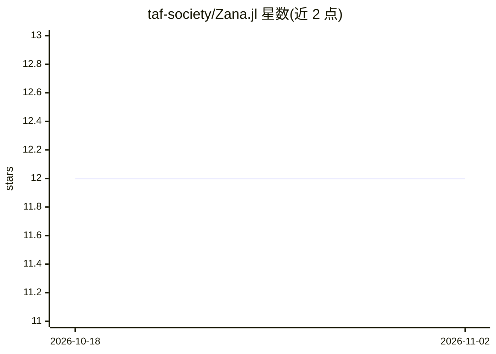

# taf-society/Zana.jl

⭐ 12 · Julia · MIT · 推送 2026-06-21 · [GitHub](https://github.com/taf-society/Zana.jl) · [官网](https://taf-society.github.io/Zana.jl/dev/) · 组织维护

**Julia 开发者的 REPL 内 AI 编程助手，连接多种 LLM**

由非营利协会 TAFS 维护的 Julia 包，在 REPL 中提供交互式 AI 编程助手：接入 Anthropic Claude、OpenAI、Ollama 或任意 OpenAI 兼容 API，向模型开放 7 个代码库工具（读/写/编辑文件、执行 shell 命令、glob/grep/列目录），并提供 REPL 命令（/history、/tokens 等）、ZanaAgent 程序化接口与 Ollama 实用工具。依赖仅 HTTP/JSON3/UUIDs。包尚在开发中，通过 GitHub 以 Pkg.add 安装，官方发布后支持 Julia 包管理器安装。

## 筛选速览

| 维度 | 判定 | 备注 |
|---|---|---|
| AI 角色 | `ai-native` | 本体是模型或模型工具 |
| 许可风险 | `permissive` | MIT |
| 部署形态 | `None` |  |
| 模型依赖 | local-ok | 支持本地模型 |
| 硬件要求 | — | 无带数字的原话,不猜 |
| 安装摩擦 | `low` | 无编译、无系统依赖或容器化 |
| 成熟度 | `idea` | |

## 能力要点

- 支持 OpenAI、Anthropic、Ollama 及任意 OpenAI 兼容 API 后端
- 7 个代码库操作工具：read/write/edit_file、run_bash、glob/grep/list
- ZanaAgent 程序化 Agent API，返回工具执行记录与 token 用量
- 依赖极少（HTTP、JSON3、UUIDs）

## 适用场景

- 在 Julia REPL 中与 LLM 对话式地编写和修改项目代码
- 通过本地 Ollama 模型进行离线 AI 辅助编程
- 以程序化方式在脚本中调用带工具的 agent 完成代码任务

## 场景标签

`编码 Agent` · 领域:编码与开发

## 证据(README 行号)

> L7: **Zana** is a REPL-based AI coding copilot for Julia. It connects to LLMs (OpenAI, Anthropic Claude, Ollama, or any 
> L109: Zana gives the LLM 7 tools to work with your codebase:

## 星数曲线

2026-10-18 12 → 2026-11-02 12（+0）

---
*卡片 v1 · prompt 1.4 · 生成 2026-10-31 · 置信度 high · 依据 README sha `a82a62e7dde9` · [字段定义](../../DATASET.md)*
