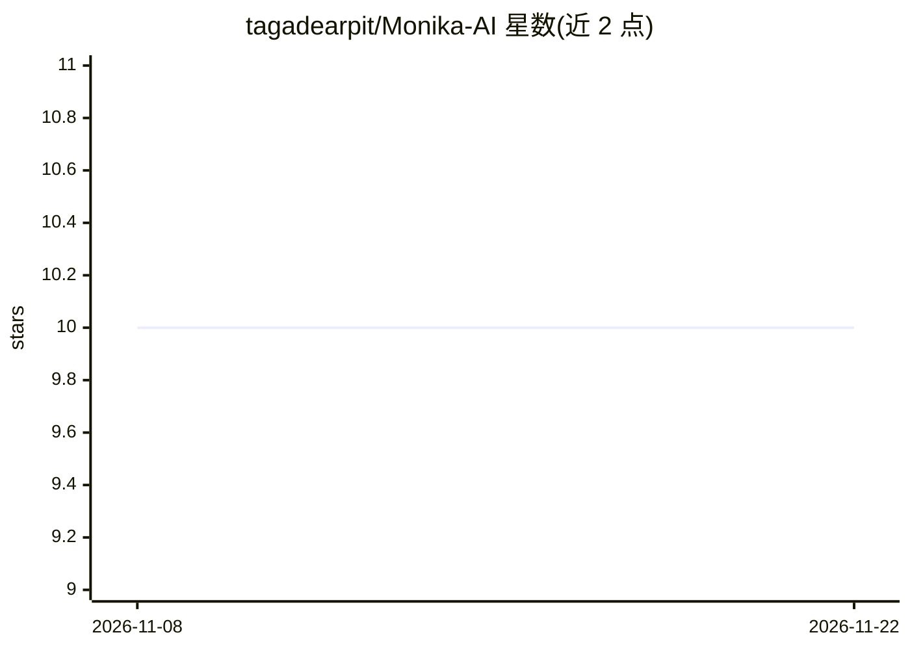

# tagadearpit/Monika-AI

⭐ 10 · JavaScript · Apache-2.0 · 推送 2026-11-17 · [GitHub](https://github.com/tagadearpit/Monika-AI) · [官网](https://monika-ai-0jpf.onrender.com) · 个人维护

**基于 Gemini 的 AI 陪伴聊天应用，带前端与后端**

一个全栈 AI 伴侣应用，后端 Node.js/Express/MongoDB，前端为 PWA；核心是调用 Google Gemini 生成流式对话回复。围绕对话提供多会话管理、可编辑记忆、附件（图片/PDF/文本）发送、语音输入与 TTS 播放、基于 Gemini 解析自然语言的提醒、Google/手机/邮箱 OTP 登录、设备管理与按用户用量限额。README 同时列出未含对象存储、分布式队列、双因素认证等未实现项。

## 筛选速览

| 维度 | 判定 | 备注 |
|---|---|---|
| AI 角色 | `ai-native` | 本体是模型或模型工具 |
| 许可风险 | `permissive` | Apache-2.0 |
| 部署形态 | `self-host` | docker 或自建部署 |
| 模型依赖 | — | README 未给出锁定关系 |
| 硬件要求 | — | 无带数字的原话,不猜 |
| 安装摩擦 | `low` | 无编译、无系统依赖或容器化 |
| 成熟度 | — | 结构信号不足 |

## 能力要点

- 流式 Gemini 回复，支持停止/重新生成/继续/编辑重发
- 可编辑的记忆系统，可关闭自动记忆并带来源与置信度元数据
- 语音转文字输入与自动 TTS 播放，支持免提模式
- 多方式登录（Google/手机 OTP/邮箱 OTP）与多设备会话管理

## 适用场景

- 部署一个私人 AI 聊天伴侣网站
- 对话中自动记录并手工管理记忆要点
- 用自然语言创建提醒并接收推送通知

## 场景标签

`聊天机器人` `AI 助手` `语音合成` · 领域:对话与助手

## 证据(README 行号)

> L3: Monika AI is a full-stack AI companion built with **Node.js, Express, MongoDB, Google Gemini, Firebase, Google Sign-
> L35: - Streaming Gemini responses

## 星数曲线

2026-11-08 10 → 2026-11-22 10（+0）

---
*卡片 v1 · prompt 1.4 · 生成 2026-11-19 · 置信度 high · 依据 README sha `f882bd4ccb15` · [字段定义](../../DATASET.md)*
