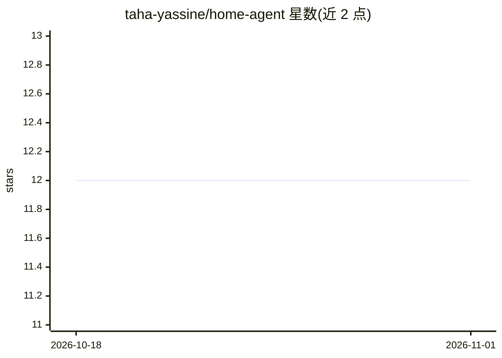

# taha-yassine/home-agent

⭐ 12 · Python · 推送 2025-11-21 · [GitHub](https://github.com/taha-yassine/home-agent) · 个人维护

**为 Home Assistant 增加本地对话与自动化 Agent 的集成模块**

由两部分组成：管理 AI agent 并提供编排能力的 Home Assistant add-on，以及接入 Home Assistant 处理对话的 custom component。支持多轮对话、控制家居、tracing 与 LLM 后端管理；工具管理、MCP servers、RAG、操作权限确认与 token 用量监控为待实现项。安装需先装 add-on（经 add-on store），再通过 HACS 装 custom component 并重启。README 声明项目处于活跃开发中，尚不可用，可能存在 bug 与破坏性变更。

## 筛选速览

| 维度 | 判定 | 备注 |
|---|---|---|
| AI 角色 | `ai-native` | 本体是模型或模型工具 |
| 许可风险 | `none` | — |
| 部署形态 | `None` |  |
| 模型依赖 | — | README 未给出锁定关系 |
| 硬件要求 | — | 无带数字的原话,不猜 |
| 安装摩擦 | `low` | 无编译、无系统依赖或容器化 |
| 成熟度 | `idea` | |

## 能力要点

- add-on + custom component 双组件架构
- 多轮对话与控制家居功能已实现
- LLM 后端管理与 tracing
- 工具管理/MCP/RAG 等功能为 WIP 状态

## 适用场景

- 用对话方式控制 Home Assistant 智能家居设备
- 在本地运行 agentic LLM 执行家居自动化任务
- 为 Home Assistant 增加带追踪能力的 AI 对话入口

## 场景标签

`聊天机器人` · 领域:对话与助手

## 证据(README 行号)

> L3: Home Agent is an AI module for Home Assistant that adds powerful conversational and automation capabilities to your 
> L16: 2. **Add-on**: Manages AI agents and provides advanced orchestration capabilities
> L24: - [x] LLM backends management

## 星数曲线

2026-10-18 12 → 2026-11-01 12（+0）

---
*卡片 v1 · prompt 1.4 · 生成 2026-10-31 · 置信度 high · 依据 README sha `8dafd6640329` · [字段定义](../../DATASET.md)*
