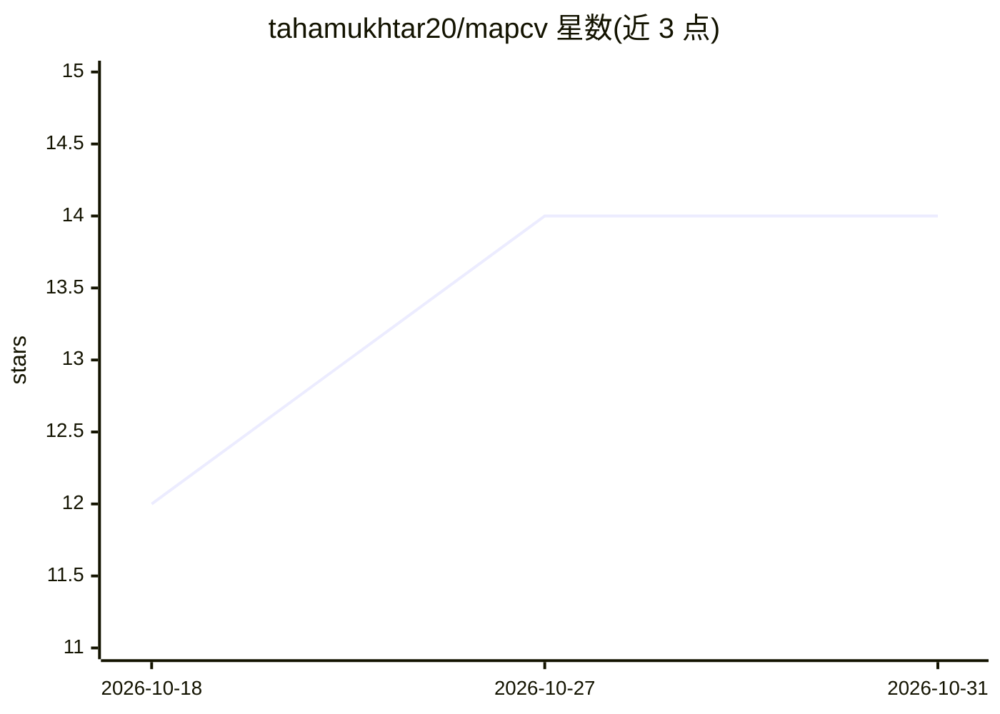

# tahamukhtar20/mapcv

⭐ 14 · Python · MIT · 推送 2026-10-26 · [GitHub](https://github.com/tahamukhtar20/mapcv) · [官网](https://tahamukhtar20.github.io/mapcv/) · 个人维护

**把影像与地理标签转成可训练遥感数据集的命令行工具**

面向遥感机器学习研究者的数据集构建工具：通过一个 YAML 配置，从 XYZ 瓦片、本地/URL/S3 的 GeoTIFF/COG、Sentinel-2（EOPF Zarr 或 STAC COG）、Google Earth Engine 等影像源读取数据，将 GeoJSON/KML/Shapefile 等标签栅格化，切片输出 PNG/JPEG/GeoTIFF/NPY 补丁、清单与防泄漏的 train/val/test 划分，并可导出 Hugging Face Parquet、WebDataset、Zarr 等格式供 PyTorch 训练。提供 mapcv init/generate/split/stats/card/verify 命令行流程，另提供 MCP server 供 AI agent（Claude Code、Cursor 等）调用，默认只读并限制在单文件夹内。

## 筛选速览

| 维度 | 判定 | 备注 |
|---|---|---|
| AI 角色 | `ai-ecosystem` | LLM/agent 周边工具 |
| 许可风险 | `permissive` | MIT |
| 部署形态 | `library` | 以包/库形式分发 |
| 模型依赖 | — | README 未给出锁定关系 |
| 硬件要求 | — | 无带数字的原话,不猜 |
| 安装摩擦 | `medium` | 含编译或系统依赖之一 |
| 成熟度 | — | 结构信号不足 |

## 能力要点

- 单一 YAML 配置生成含防泄漏划分的遥感训练数据集
- 支持多影像源（XYZ 瓦片、GeoTIFF/COG、Sentinel-2、Earth Engine）与多标签格式
- 导出 Hugging Face Parquet / WebDataset / Zarr，附 MapcvDataset PyTorch 加载器
- 可选 MCP server 供 AI agent 检查标签、校验与生成数据集

## 适用场景

- 从航空影像与建筑物标签构建语义分割/实例分割训练集
- 把 Sentinel-2 影像与 STAC 目录数据做成变化检测数据集
- 为已有补丁数据重新划分 train/val/test 并生成数据集卡片

## 场景标签

 · 领域:地球观测/遥感数据处理

## 证据(README 行号)

> L43: Building a machine-learning dataset from geospatial data usually means a one-off script: fetch or read imagery, bur
> L48: - **Output:** PNG/JPEG/GeoTIFF/NPY patches, a manifest, leakage-safe splits, and exports to Hugging Face Parquet, W

## 星数曲线

2026-10-18 12 → 2026-10-31 14（+2）

---
*卡片 v1 · prompt 1.4 · 生成 2026-10-31 · 置信度 high · 依据 README sha `247e98e33140` · [字段定义](../../DATASET.md)*
