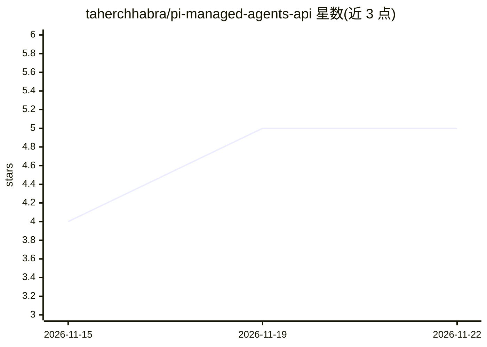

# taherchhabra/pi-managed-agents-api

⭐ 5 · TypeScript · 推送 2026-11-15 · [GitHub](https://github.com/taherchhabra/pi-managed-agents-api) · 个人维护

**自托管托管 agent API：给自己的应用提供可持久会话的 agent 运行时**

基于 Pi coding agent SDK 构建的自托管 API 与浏览器控制台：定义带版本化的 agent、分配工作区并提交任务，服务保存会话状态、在 Docker 工作区或 QEMU/KVM Linux 桌面中执行 Bash/Python、记录事件并发布 outputs/ 下的文件产物。通过 HTTPS 从应用后端调用，支持可恢复的 SSE 事件流与显式恢复流程。README 声明 MVP 阶段尚无输入上传 API、token 流式增量、MCP 自定义工具、调度与子代理等功能，也未提供高可用与配额管理。

## 筛选速览

| 维度 | 判定 | 备注 |
|---|---|---|
| AI 角色 | `ai-ecosystem` | LLM/agent 周边工具 |
| 许可风险 | `none` | — |
| 部署形态 | `self-host` | docker 或自建部署 |
| 模型依赖 | locked-api |  |
| 硬件要求 | — | 无带数字的原话,不猜 |
| 安装摩擦 | `low` | 无编译、无系统依赖或容器化 |
| 成熟度 | `idea` | |

## 能力要点

- 版本化 agent + 持久会话上下文与工作区文件
- Docker 工作区与 QEMU/KVM Linux 桌面两种执行环境（桌面支持 Off/Internet/域名白名单网络策略）
- 保存生命周期/工具/结果事件的 SSE 流与可恢复读取
- 浏览器控制台：会话检查器、工具调用追踪、产物预览下载

## 适用场景

- 给自己应用的后端接入一个可跑代码、保留上下文的 agent API
- 让 agent 在持久 Linux 桌面中操作真实应用并接续上一次任务
- 在自己的 VPS 上托管 agent 运行时，模型凭据留在服务器端

## 场景标签

`Agent 框架` `编码 Agent` · 领域:Agent 开发

## 证据(README 行号)

> L9: Useful agents need a place to work, a way to carry context into the next task, and a record of what happened. Pi Man
> L11: Define an agent, give it a workspace, and send it a task. Pi handles the model and tool loop; the service saves ses
> L40: |Host the API, harness, and session storage yourself|**Yes.** Docker Compose deployment on one Linux VPS|OpenAI run

## 星数曲线

2026-11-15 4 → 2026-11-22 5（+1）

---
*卡片 v1 · prompt 1.4 · 生成 2026-11-21 · 置信度 high · 依据 README sha `cee0b8172b2f` · [字段定义](../../DATASET.md)*
