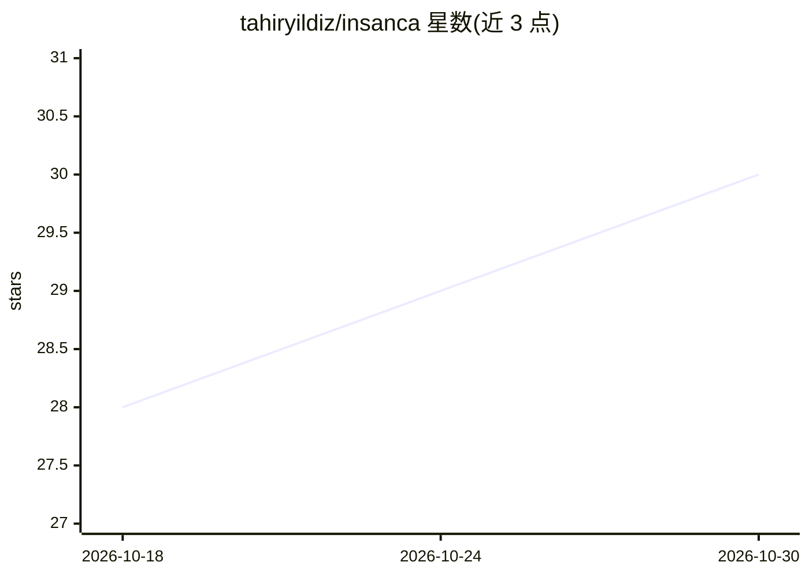

# tahiryildiz/insanca

⭐ 30 · MIT · 推送 2026-07-27 · [GitHub](https://github.com/tahiryildiz/insanca) · 个人维护

**清除土耳其语 AI 写作痕迹的 agent 技能，重写为自然人类文风**

面向支持 skill 的 agent 环境（Claude Code、OpenCode、Codex 等）的纯 Markdown 技能：读取土耳其语文本，按 48 个 AI 痕迹模式（节奏、词汇、翻译腔、语气、格式、可信度六组）逐一诊断，再用源自真实土耳其语散文的 17 条行文规则重写，并以三步循环（草稿—自查—数值校验）执行。另对成稿做句长多样性、破折号/分号计数、三段式密度等量化检测；不改动引语、标题与专有名词，也保留人类写作痕迹。

## 筛选速览

| 维度 | 判定 | 备注 |
|---|---|---|
| AI 角色 | `ai-native` | 本体是模型或模型工具 |
| 许可风险 | `permissive` | MIT |
| 部署形态 | `library` | 以包/库形式分发 |
| 模型依赖 | — | README 未给出锁定关系 |
| 硬件要求 | — | 无带数字的原话,不猜 |
| 安装摩擦 | `low` | 无编译、无系统依赖或容器化 |
| 成熟度 | — | 结构信号不足 |

## 能力要点

- 48 个 AI 痕迹模式分六组诊断
- 17 条源自真实土耳其语散文的行文重写规则
- 对成稿做句长多样性、kafiye 比例等数值化检测（GPTZero/GLTR/DetectGPT 思路）
- 三步循环：草稿—自查—数值阈值校验

## 适用场景

- 把 AI 生成的土耳其语文本改写得更像人写
- 发表前清除 AI 痕迹明显的套话与结构
- 在 Claude Code 等 agent 环境中按需调用该写作技能

## 场景标签

`AI 写作` · 领域:内容生成

## 证据(README 行号)

> L9: İnsanca bu sorunu çözmek için var. Bir agent skill'i olarak metni alıyor, yapay zeka kokusunu tek tek teşhis ediyor 
> L11: İki parçadan oluşuyor: **48 kalıp** yapay zeka izini yakalıyor, **17 akış kuralı** da boşalan yere gerçek Türkçenin

## 星数曲线

2026-10-18 28 → 2026-10-30 30（+2）

---
*卡片 v1 · prompt 1.4 · 生成 2026-10-26 · 置信度 low · 依据 README sha `09dd8f1f18ea` · [字段定义](../../DATASET.md)*
